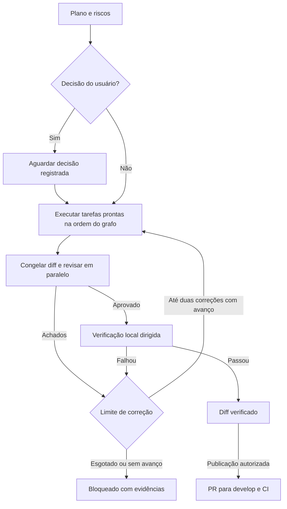

# Operação do /ship

Execute da raiz do checkout com Claude Code 2.1.319+, Git e Python 3.11+. Para o gate de aplicativo, prepare as dependências locais já usadas pelo MuscleFit. Consulte o README da entrega para instalação e rollback.

```powershell
python .claude/scripts/lead.py
```

Dentro da sessão use `/ship plano <objetivo>`, `/ship <objetivo>` ou `/ship retomar`. Um objetivo expresso como pedido de plano fica em leitura. O lead decide a arquitetura e usa o grafo para o trabalho autorizado. Solicite explicitamente a abertura do PR se ela fizer parte da entrega.



## Catálogo de agentes

| Papel | Modelo padrão | Quando usar |
|---|---|---|
| `tech-lead` | `best` pelo launcher | Planejamento, dependências, arbitragem e gates |
| `Explore` | `haiku` pedido ao Agent | Busca de arquivos, inventário e leitura delimitada |
| `docs-curator` | `haiku` | Documentar decisões já tomadas |
| Backend, frontend, fullstack, AWS, IA, Zepp e QA | `sonnet` | Implementar, testar e relatar evidências no escopo atribuído |
| Revisores de código, motores, segurança e produção | `sonnet` | Parecer em contexto novo e somente leitura |
| Especialista ou revisor designado | `opus` por chamada | Contrato transversal, risco alto ou dificuldade técnica comprovada |

Os autores têm até 35 turnos por invocação e revisores até 18. Um retorno parcial não vale como conclusão. Rode uma tarefa de escrita por vez e no máximo três revisores em paralelo. QA escreve só testes atribuídos e o revisor de código examina também esse diff. Se a configuração da organização substituir um modelo ou o alias herdar a versão da família da sessão, veja o modelo em `/tasks`. Preço efetivo e limite de uso dependem do provedor e do plano.

## Contrato dos dados

Mantenha entradas JSON em `.claude/local-state/ship-input/`. O diretório `ship/` guarda estado, logs, recibos e diff congelado. Ambos ficam fora dos commits. Sempre execute o script a partir da raiz do checkout. Os exemplos abaixo são estruturais.

```json
{
  "goal": "Documentar contrato e exemplo",
  "risks": [],
  "tasks": [
    {
      "id": "contrato",
      "agent": "docs-curator",
      "files": ["docs/contrato.md"],
      "deps": [],
      "acceptance": "Descrever a fonte do comportamento e os limites."
    },
    {
      "id": "exemplo",
      "agent": "docs-curator",
      "files": ["docs/exemplo.md"],
      "deps": ["contrato"],
      "acceptance": "Validar um exemplo pelo contrato."
    }
  ]
}
```

Valores de `risks`: `motores`, `producao` e `seguranca`. O grafo acrescenta revisores por caminhos de risco conhecidos. Classifique também mudanças semânticas que apareçam em consumidores, telas e prompts. Cada caminho exato pertence a uma tarefa. Em renomeação, inclua caminho antigo e novo. Atribua alterações de submódulo pelo caminho do gitlink e valide o trabalho no repositório do submódulo.

Opcionalmente inclua `gate` no plano ou registre depois com `gate <arquivo>`. A escolha registrada deve ser repassada às tarefas afetadas.

```json
{
  "question": "Qual comportamento queremos diante de evidência ambígua?",
  "impact": "Afeta a classificação mostrada ao usuário.",
  "recommendation": "estavel",
  "options": {"estavel": "Manter estável", "insuficiente": "Exibir evidência insuficiente"}
}
```

O Tech Lead apresenta `confirmations.gate` com o formulário nativo `AskUserQuestion`. Selecione e envie uma opção na própria conversa. O hook associa a resposta à sessão, à chamada e ao gate pendente. A execução continua quando o checkpoint registrar a escolha. Cancelar o formulário, responder em texto livre ou deixar a pergunta expirar mantém a decisão pendente. Para encerrar a execução, peça ao Tech Lead e confirme no formulário de encerramento.

| Comando do grafo | O que registra ou confere |
|---|---|
| `start plano.json` | DAG válido, branch e base limpas. Só um run por checkout |
| `status` | Estado, tarefas prontas, formulários, decisões, revisores, recibos e evidências |
| `claim ID` e `report ID resultado.json` | Início e fim do autor. Resultado contém `status` (`done` ou `blocked`) e `evidence` |
| `review` e `verdict REVISOR parecer.json` | Parecer sobre a revisão congelada. Informe `revision`, `agent_id` observado em recibo, `status` (`pass`, `changes`, `blocked`) e `evidence` |
| `verify testes.json` | Roda `verify.py` e registra exit code e log. O manifesto contém `backend_tests` e `frontend_tests` como listas de caminhos relativos |
| `rework ID [ID ...]` | Reabre apenas os autores afetados. Revisa e verifica o diff inteiro novamente |
| `ready` | Compara a versão pronta com a revisão aprovada e validada |
| `archive` | Arquiva um estado terminal após a conclusão ou o encerramento confirmado, preservando os arquivos |

Todos os comandos usam o prefixo `python .claude/scripts/ship.py`. Use status após interrupção e procure um autor ainda ativo em `/tasks`. Se `origin/develop` mudar, preserve o diff, encerre a execução e monte um novo plano após integrar a base. Se a máquina cair deixando a pasta `lock`, confirme que nenhum processo do grafo está ativo antes de removê-la. O checkpoint também guarda decisões humanas. Para conhecimento durável, use ADRs e o mapa de motores, sem transferir automaticamente transcrições para memória compartilhada.

Gate humano cabe em mudança de comportamento público sem critério decidido, dados ou migração irreversível, custo relevante, exposição externa ou risco de produção. Uma preferência reversível de implementação cabe ao lead. A publicação do /ship é PR para `develop`. A promoção segue o comando manual preservado e a autorização específica da política do projeto.

Os hooks são proteções operacionais dentro do Claude Code. A conta local, scripts arbitrários e permissões de outros canais continuam com seus próprios poderes. O recibo atesta que houve conclusão observada de um revisor nativo no estágio, e o lead ainda precisa registrar fielmente o parecer. Se faltar recibo, verifique `/hooks`, a confiança no checkout e a versão, e rode novamente o revisor necessário. Preserve a proteção de branches e o CI no GitHub.
