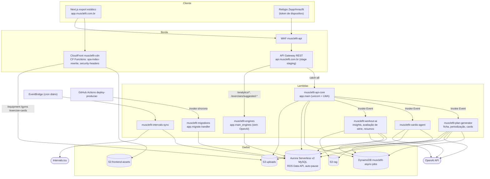
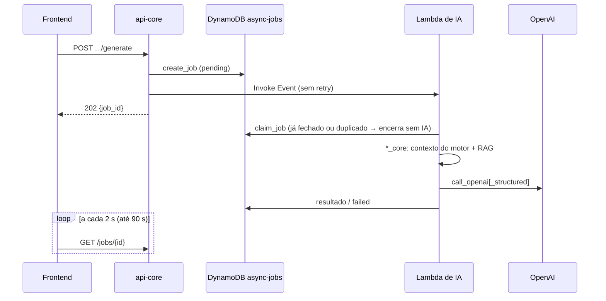
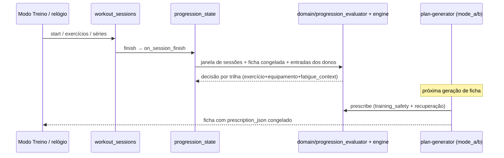

# Codebase Map — MuscleFit

> Gerado pelo Cartographer (8 leitores em paralelo, leitura por docstrings/assinaturas/greps). Último mapeamento: 2026-10-13 12:58 UTC, `develop` em `c3b61d6`.
> Contagens excluem `.claude/worktrees/`. Arquivos muito grandes foram lidos por definições, não linha a linha — confirme no código antes de decisões finas.
> A regra permanente **"Motores: fonte única da verdade"** manda: o dono de cada regra está em [`docs/motores/FONTES_DA_VERDADE.md`](motores/FONTES_DA_VERDADE.md); este mapa só aponta para ele.

## Visão geral do sistema

App pessoal de treino de musculação (multiusuário: admin, personal trainer, aluno). Frontend Next.js exportado estático em S3/CloudFront; API FastAPI em Lambdas de imagem atrás do API Gateway; Aurora Serverless v2 MySQL acessado pela RDS Data API; IA (OpenAI) só em Lambdas assíncronas; motores determinísticos de recuperação/progressão/volume em Python puro.



**Stack**: Python 3.12, FastAPI 0.141/Starlette 1.x (com `fastapi_compat` mantendo comportamento 0.115), Pydantic 2, boto3, PyMySQL (só dev), Pillow; Next.js 14.2 App Router, React 18, TypeScript strict, Mantine 7, TanStack Query 5, recharts, vitest; Terraform (AWS provider ~>5, sa-east-1); Docker Compose + LocalStack no dev.

## Estrutura de diretórios

```
muscle_fit/
├── api/                       Backend Python (uma base de código → 3 imagens / 7 Lambdas)
│   ├── app/                   ~150 módulos soltos + subpacotes
│   │   ├── main.py            App api-core (rotas de atividades/exercícios/IA + ~40 routers)
│   │   ├── main_engines.py    App engines (analytics, dashboards, engines_extra)
│   │   ├── lambda_*.py        Entrypoints awslambdaric (plan-generator, cardio, workout-ai, intervals-sync)
│   │   ├── migrate.py         Runner de migrações + handler da Lambda migrations
│   │   ├── domain/            Regras puras dos motores (progressão, segurança, e1RM, prescrição…)
│   │   ├── intelligence/      Motores de leitura: recuperação, volume, metodologia, dashboard, insights, relatório
│   │   ├── generation/        Geração determinística de ficha (mode_a/mode_b, freeze, auditoria)
│   │   ├── periodization/     Geração de Modelo por IA (rascunho) + validador + limites/tempo
│   │   └── assets/            Bodymap v1, fontes, logo (lidos por Pillow)
│   ├── db/migrations/         001–021 .sql (baseline) + 022–072 .py (`up(db)`)
│   ├── tests/                 unit/ (sem banco), integration/ (MySQL), eval/ (LLM), support/
│   ├── scripts/               Replay de progressão, diff de replay, calibração de cards, lock de deps
│   ├── vendor/                Lambda Web Adapter 0.9.1 vendorizado (x86_64)
│   ├── privado/               Submódulo privado muscle_fit_privado (M103): rag/markdown/ (HIPERTROFIA, PROGRESSAO, grupos, TIPOS_TREINO/) e prompts/
│   └── Dockerfile{,.engines,.ai,.dev,.engines.dev}
├── frontend/                  Next.js (output: 'export' fora do `next dev`)
│   ├── src/app/               Rotas: (app)/ com AppShell, (fullscreen)/modo-treino, páginas públicas
│   ├── src/lib/               Lógica pura testada, tipos, cliente de API, espelhos gerados do backend
│   ├── src/components/        Shell, átomos de dashboard, mapa corporal, associação de exercícios
│   ├── scripts/               Preview/smoke do export, gerador de regiões do bodymap, ícones
│   └── public/                PWA, logo, assets do bodymap v1
├── infra/                     Terraform (state S3 + lock DynamoDB), iam-policies/, cloudfront-functions/
├── docs/                      motores/FONTES_DA_VERDADE.md, auditoria, investigações, runbooks, ia, dashboard
├── scripts/                   prod_to_dev.py, dev.ps1, cobertura de Lambdas no deploy, invalidação CF, IAM
├── tools/                     onprem-sync (MySQL on-prem → Aurora), bodymap (pipeline offline da arte)
├── .github/workflows/         CI por área (PR) + deploy-producao manual
├── .claude/                   agents/, hooks/ (guardas), skills/ (atualizar-dev, promover-producao)
├── docker-compose.yml, Makefile, nginx/, localstack/, dev/   Ambiente local
└── MUSCLE_FIT.md              Documento descritivo longo (~590 KB, base 2026-09-12) para contexto de LLM
```

## Guia de módulos

### Backend — entrada, base e auth (`api/app/`)

**Entry points**: `main.py` (api-core), `main_engines.py` (engines), `lambda_plan_generator.py`, `lambda_cardio_agent.py`, `lambda_workout_ai.py`, `lambda_intervals_sync.py`, `migrate.handler`.

| Arquivo | Propósito |
|---|---|
| `main.py` | `load_secrets()` → logging → FastAPI → CORS, `AccessLogMiddleware`, `RequestMemoMiddleware` → handler 403 `must_change_password`; rotas de `/activities`, `/exercises/*`, IA assíncrona (202); inclui ~40 routers |
| `main_engines.py` | Routers `analytics`, `dashboard_modules`, `dashboard_intelligence`, `analytics_dashboard`, `engines_extra` |
| `db.py` / `db_dataapi.py` / `db_pymysql.py` | Dispatcher por `DB_BACKEND` (default `data-api`); mesma superfície (`get_conn`, `transaction`, erros) nos dois backends |
| `security.py` | `get_current_identity` (header `X-API-Token` > cookie `musclefit_session`; token mestre, de dispositivo ou de sessão), `require_admin`, `require_admin_or_pt`, `MustChangePasswordRequired`, `AuthBackendUnavailable` (503) |
| `auth.py` | `/auth/login`, `/logout`, `/me`, `/change-password` (com `login_throttle`, `client_ip`, `captcha`) |
| `password_reset.py` | `/auth/password-reset/{request,confirm}` com Turnstile + SES |
| `users.py`, `devices.py` | CRUD de usuários/foto; dispositivos por usuário (M40: pareamento pelo perfil, token `mfd_` só como SHA-256, age em nome do dono; `GET /devices/me`) |
| `secrets_bootstrap.py` | Secrets Manager → `os.environ` no cold start; impede segredo padrão |
| `async_jobs.py`, `jobs.py` | Jobs no DynamoDB (`ASYNC_JOBS_TABLE`) + `GET /jobs/{id}` (polling) |
| `cors_config.py`, `client_ip.py`, `access_log.py`, `request_memo.py`, `parallel_reads.py`, `catalog_reads.py`, `logging_config.py`, `observability.py`, `api_docs.py`, `fastapi_compat.py`, `crypto_utils.py` | Infra transversal (CORS explícito, IP real via X-Forwarded-For, log JSON, memo por request, leituras paralelas para a Data API, `/docs` só em dev, Fernet) |
| `request_models.py`, `models.py` | Pydantic (`extra="forbid"`, limites de tamanho) |
| `schema_guards.py`, `*_schema.py` | Detecção de tabela de migração recente; guards legados só rodam em `pymysql` |
| `migrate.py`, `replay_progression.py` | Migrações (checksum, lease lock) e replay das trilhas de progressão |

### Backend — treino, fichas e Modelos (`api/app/`)

| Arquivo | Propósito |
|---|---|
| `services.py` (~3.000 linhas) | Camada de dados/regras de atividades, séries, fichas, freeze de prescrição, mapa corporal |
| `workout_sessions.py` | Gravação ao vivo (relógio/Modo Treino): start → exercícios → séries → finish (dispara `progression_state.on_session_finish`) |
| `workout_plans.py`, `workout_plan_equipment.py`, `plan_generation_core.py` | Fichas: CRUD, refresh de prescrição, troca de equipamento, `POST /workout-plans/generate` (202) |
| `workout_plan_templates.py` (~2.500 linhas) | Modelos: CRUD, versões, rascunho, atribuições, preview de ativação, metodologia, `POST /periodization-drafts` |
| `template_versions.py`, `template_drafts.py`, `template_assignments.py`, `template_safety_validation.py` | Versão imutável vigente (065), rascunho (067), atribuição vigente (049), validação de segurança dos itens |
| `training_types.py`, `training_type_targets.py` | Tipos de treinamento e metas semanais por grupo com vigência |
| `progression.py`, `progression_state.py` | Leitura de trilhas/decisões; fronteira entre o motor puro e as tabelas da 036 |
| `gyms.py`, `equipment_exercises.py`, `gym_equipment_sync.py`, `equipment_recommender.py`, `equipment_exercise_preferences.py`, `load_conventions.py` | Academias, equipamentos, relação canônica equipamento×exercício, recomendador, estrelas por usuário, convenção de carga (NULL = total) |
| `exercise_catalog_admin.py`, `exercise_mapping_catalog.py`, `exercise_mapping_canonical.py`, `advanced_techniques.py` | Admin do catálogo, aliases, grupos musculares, contribuições, mapeamentos, técnicas avançadas |
| `exercise_card*.py`, `body_map_render.py`, `muscle_map.py` | Cards ilustrados (máquina de estados, prompt, job, composição Pillow, S3 rascunho/final) e PNG do mapa corporal |
| `exercise_briefing.py`, `exercise_description_*.py` | Briefing pré-exercício e descrição de execução por IA (gera uma vez, autogen em segundo plano) |
| `set_types.py`, `weight_units.py` | Vocabulário canônico de `set_type`; kg no banco, lb só na borda |
| `intervals_*.py` | Intervals.icu: cliente urllib, store, rotas `/integrations/intervals`, sync agendado, classificação e match por horário |
| `body_composition.py`, `body_measurements.py`, `context_events.py`, `daily_checkins.py`, `sleep_metrics.py`, `manual_effort_metrics.py` | CRUDs de dados do usuário (a engines só lê) |
| `reports.py` | `GET /reports/markdown` (sem IA; usa `intelligence/report/*`) |

### Backend — IA (`api/app/`)

Padrão: rota cria job (202) → Lambda assíncrona reivindica o job (`async_jobs.claim_job`, M81: job já fechado como `worker_lost` ou entrega duplicada não chama a IA) → roda `*_core.py` → `*_ai.py` monta prompt (`*_prompt.py`) → `openai_client.call_openai[_structured]` (OpenAI por urllib, `/v1/responses`, sem SDK; ou Claude por feature, ver abaixo) → resultado no banco/DynamoDB. Texto livre do usuário passa por `prompt_user_data.py` (`<dados_do_usuario>`). Decisão do motor chega pronta via `engine_decision_context.py`.

| Feature | Arquivos | Env do modelo |
|---|---|---|
| Insights | `insights_ai.py`, `insights_core.py`, `insights_prompt.py` | `OPENAI_INSIGHTS_MODEL` |
| Avaliação de série | `exercise_set_evaluation_ai.py` | `OPENAI_SET_EVAL_MODEL` |
| Resumo de exercício / treino | `exercise_summary_ai.py`, `workout_summary_ai.py` | `OPENAI_EXERCISE_SUMMARY_MODEL`, `OPENAI_WORKOUT_SUMMARY_MODEL` |
| Análise de evolução | `workouts_analysis*.py`, `report_ai.py` | — |
| Cardio | `cardio_agent_ai.py`, `cardio_generation_core.py`, `cardio_recommendations.py` | `OPENAI_MODEL_CARDIO` |
| Ficha por IA (legado) | `workout_plan_ai.py`, `workout_plan_templates_engine.py` | `OPENAI_MODEL_PLAN` |
| Periodização (Modelo) | `periodization/*` | `OPENAI_MODEL_PERIODIZATION` (sem default) |
| Cards ilustrados | `exercise_card_*` | config de imagem |
| RAG | `rag_chunking.py` (seletivo por grupo), `rag_storage.py` (hidrata do S3) | `RAG_MARKDOWN_DIR`, `RAG_S3_BUCKET` |

#### Provedor LLM por feature (OpenAI × Anthropic)

O cliente único continua sendo `openai_client.call_openai`, `call_openai_structured` e `call_openai_structured_vision` (assinaturas iguais; novo kwarg opcional `cache_prefix`), mais `call_openai_text` (texto + modelo que respondeu, `TextResult`). Por `feature` (o rótulo do `llm.usage`), `_dispatch` decide o provedor: **padrão `openai` em toda feature**, com o mesmo corpo HTTP de antes (snapshots intactos). Com `LLM_PROVIDER_<FEATURE>=anthropic`, a chamada vai para `llm_anthropic.py` (SDK oficial `anthropic`, importado só nesse caso).

- **Envs** (`<FEATURE>` = rótulo em maiúsculas: `SET_EVALUATION`, `EXERCISE_SUMMARY`, `WORKOUT_SUMMARY`, `EXERCISE_DESCRIPTION`, `INSIGHTS`, `WORKOUTS_ANALYSIS`, `CARDIO_AGENT`, `PERIODIZATION`, `MEAL_PARSE`, `LABEL_PHOTO`, `WORKOUT_PLAN`): `LLM_PROVIDER_<FEATURE>` (`openai`|`anthropic`), `ANTHROPIC_MODEL_<FEATURE>` (padrão: `claude-haiku-5-5` em avaliação de série e resumos; `claude-sonnet-5-5` nas demais), `ANTHROPIC_EFFORT_<FEATURE>` (padrão `low` nas três leves, `medium` nas demais), `LLM_FALLBACK_PROVIDER_<FEATURE>` ou `LLM_FALLBACK_PROVIDER` (`openai` liga o fallback), `ANTHROPIC_API_KEY` (de `ANTHROPIC_API_KEY_SECRET_ARN`, secret `musclefit/claude-api-key`, via `secrets_bootstrap.py`).
- **Terraform** (`infra/llm_providers.tf`): `llm_provider_by_feature`, `anthropic_model_by_feature`, `anthropic_effort_by_feature`, `llm_fallback_provider_by_feature` (mapas) e `llm_fallback_provider` (global, padrão `""`) viram `local.llm_provider_env`, publicado só em api-core, plan-generator, cardio-agent e workout-ai (as mesmas que leem a chave da OpenAI). **Ligar/desligar uma feature** = PR que põe/tira a linha dela em `llm_provider_by_feature`.
- **Quem usa qual provedor (virada de 2026-10-31, eval em `docs/ia/EVAL_ANTHROPIC_2026-10-30.md`):**

  | Feature | Provedor | Modelo | Esforço | Fallback | Lambda |
  |---|---|---|---|---|---|
  | `cardio_agent` | Anthropic | `claude-haiku-5-5` | `medium` | OpenAI | cardio-agent |
  | `label_photo` | Anthropic | `claude-haiku-5-5` | `medium` | OpenAI | plan-generator |
  | `exercise_description` | Anthropic | `claude-haiku-5-5` | `medium` | OpenAI | plan-generator |
  | `insights` | Anthropic | `claude-haiku-5-5` | `medium` | OpenAI | workout-ai |
  | `meal_parse` | Anthropic | `claude-haiku-5-5` | `medium` | OpenAI | workout-ai |
  | `workout_summary` | Anthropic | `claude-haiku-5-5` | `low` | OpenAI | workout-ai |
  | `periodization`, `set_evaluation`, `workouts_analysis`, `exercise_summary`, `workout_plan` | OpenAI | `gpt-5.4-mini` (env `OPENAI_*` da feature) | — | — | — |

- **Modelo gravado**: a feature grava o modelo que RESPONDEU (`StructuredResult.model` ou `TextResult.model`), inclusive depois do fallback. A impressão digital do resumo de treino (`workout_summary_ai.input_fingerprint`) usa o nome configurado do modelo (`TextResult.requested_model`/`openai_client.primary_model`).
- **Cache**: a OpenAI recebe `prompt_cache_key` (grátis) nas features de `PROMPT_CACHE_KEY_FEATURES`; o `cache_control` da Anthropic só vai nas de `llm_anthropic.ANTHROPIC_CACHE_CONTROL_FEATURES` (hoje nenhuma: a escrita custa 1,25× e o volume não chega à leitura).
- **Pedido Claude**: `messages.create` com `thinking: adaptive`, `output_config.effort`, `max_tokens` = teto da feature (`LLM_MAX_OUTPUT_TOKENS`, que já conta raciocínio), sem `temperature`/`top_p`/`top_k` e sem prefill. Estruturado: `output_config.format` (`json_schema`) com o schema passado por `llm_anthropic_schema.adapt_schema` (limites de 16 uniões e 24 opcionais; o excedente de anuláveis vira opcional e `restore` devolve `null`). Visão: bloco `image` base64. Resposta lida pelos blocos `type == "text"`.
- **Prefixo de cache**: nas features de `PROMPT_CACHE_KEY_FEATURES`, o `cache_prefix` (instruções + RAG; `insight_cache_prefix`, `report_ai.build_cache_prefix`, `build_prompt_cache_prefix` da periodização, `cardio_agent_ai.cache_prefix_of`) chega ao `llm_anthropic`, mas só vira bloco com `cache_control` se a feature estiver em `ANTHROPIC_CACHE_CONTROL_FEATURES`. Não vai para a OpenAI.
- **Erros e retry**: `max_retries=0` no SDK; o retry é o do cliente (429/5xx/529 na janela de 10 s, nunca em timeout). Classes tipadas do SDK viram `OpenAIGenerationError` com mensagem genérica; códigos novos `ANTHROPIC_REFUSAL`, `ANTHROPIC_BILLING`, `ANTHROPIC_AUTH`, `ANTHROPIC_NOT_CONFIGURED`, `ANTHROPIC_CONNECTION`, `ANTHROPIC_SCHEMA_UNSUPPORTED`. `stop_reason` `max_tokens` = `llm.output_incomplete`.
- **Fallback** (`llm.fallback`): com o fallback ligado, crédito/billing, chave, erro HTTP depois do retry, conexão, schema fora do subconjunto e recusa refazem na OpenAI com o modelo OpenAI da feature e o tempo que sobrou. Timeout e saída cortada/JSON inválido não refazem (já cobrados).
- **Custo**: `llm.usage` ganha `provider` (e `cache_write_tokens` no Claude); `input_tokens` é a entrada inteira (como na OpenAI). Preço por modelo, inclusive a faixa de prompt longo do Haiku, só em `domain/nutrition/ai_usage.py` (mapa §74). Eval GPT × Claude: `tests/support/llm_eval_provider.py` (`LLM_EVAL_PROVIDER`, `LLM_EVAL_MODEL`, `LLM_EVAL_EFFORT`). Retenção: `docs/ia/RETENCAO_DADOS_ANTHROPIC.md`.

### Backend — `domain/` (regras puras, sem FastAPI)

Cada módulo é dono único de uma regra (ver FONTES_DA_VERDADE). Sem I/O, exceto `training_history.py`.

| Arquivo | Regra |
|---|---|
| `progression_engine.py` (~2.200 linhas) | Motor de Progressão v2: fase por grupo (`GroupState`), carga/séries/técnica por trilha (`TrackState`), `prescribe`, `load_increment`, `next_load`, `round_to_equipment_step` |
| `progression_evaluator.py` | `on_session_finish` puro (janela ≤21 sessões) |
| `training_history.py` | Única leitura de banco do domínio |
| `training_safety.py`, `effective_intensity.py` | Teto de RPE seguro, falha permitida, técnicas válidas; intensidade efetiva da série |
| `prescription.py`, `prescription_defaults.py`, `prescription_service.py` | Snapshot congelado, defaults de reps/RPE/descanso, sugestão para um par |
| `next_set_load.py`, `session_loads.py` | Carga da próxima série (regra do RPE 10); aquecimento/ajuste a partir da âncora |
| `e1rm.py`, `equipment_record.py` | Epley com RIR, confiável ≤12 reps; recorde por equipamento |
| `equipment_pair.py`, `equipment_ranking.py` | Coerência do par na escrita; ranking único de equipamento |
| `technique_accounting.py`, `prior_fatigue.py`, `session_fatigue.py` | Fração de série por técnica; fadiga prévia na sessão |
| `recovery_signal_summary.py`, `exercise_briefing.py`, `set_evaluation_categories.py`, `*_status_labels.py`, `cardio_policy.py` | Resumos congelados, núcleo do briefing, vocabulário e rótulos pt-BR, constantes do cardio |

### Backend — `intelligence/` (motores de leitura)

| Área | Arquivos-chave | Dono de |
|---|---|---|
| Recuperação | `muscle_recovery_service.py`, `recovery_projection.py`, `recovery_read_model.py`, `wellness_freshness.py` | Prontidão, sinais, dose reduzida `ceil(S×0,75)` mín. 1, tetos de RPE do dia |
| Volume | `volume_service.py` (~170 KB), `technique_volume.py`, `muscle_contribution_resolver.py` | Série efetiva, ativação, metas fallback, pesos por papel (leitura e `DEFAULT_WRITE_WEIGHTS` 1/0,5/0,25) |
| Metodologia | `methodology_volume.py` (puro), `methodology_volume_service.py`, `methodology_realized.py` | Faixas por grupo, janela de 7 dias, normalização semanal, blocos |
| Progressão (leitura) | `dashboard/comparability.py`, `dashboard/exposure_service.py`, `dashboard/session_records.py`, `progression_activation.py`, `exercise_performance.py`, `muscle_group_{progression,performance}.py` | Progresso/regressão/platô, recorde, teto de ativação do grupo |
| Geração de ficha v2 | `template_volume_{domain,planner,validator}.py`, `candidate_exercise_provider.py` | Orçamento por slot, reparo de ativação |
| Dashboard / insights | `dashboard/*_service.py`, `dashboard/insight_rules.py`, `dashboard/metrics_registry.py`, `dashboard/alert_state_service.py`, `dashboard/intelligence_package.py`, `dashboard/contracts.py`, `dashboard/time_windows.py` | Limiares, regras de insight, cooldown, pacote ≤40 KB para IA, fuso/`trained_at` |
| Relatório | `report/markdown_report_service.py`, `daily_breakdown.py`, `markdown_renderer.py` | Relatório Markdown diário |
| Legado | `template_ai_selector_v2.py`, `dashboard_aggregator_service.py`, `dashboard_intelligence_layer.py`, `normalization_service.py`, `progression_service.py` (residual) | Poucos ou nenhum chamador — candidatos a remoção |

### Backend — `generation/` e `periodization/`

- **`generation/`** (Modelo → ficha, determinístico): `mode_b.py` (`equipment_series`), `mode_a.py` (`percent_budget`), `*_legacy.py` em quarentena, `activation_window.py` (janela de 7 dias), `deterministic_prescription.py`, `freeze_mode_{a,b}.py` (snapshot recalculado no save com as mesmas funções puras), `exercise_substitution.py`, `generation_runs.py` (auditoria, 054), `fallback_log.py` (métrica esperada: zero), `template_request.py`. Flag: `GENERATION_ENGINE=deterministic` **e** `PROGRESSION_ENGINE=v2`; meio-termo cai no legado com `generation.flag_mismatch`.
- **`periodization/`** (IA → rascunho de Modelo, nunca grava `workout_plan_templates`): `core.py` (job, `PROMPT_VERSION`), `context.py` (contexto 100% montado no backend + RAG), `output_schema.py` (JSON Schema strict), `validation.py` (cascata schema → referencial → regras do save → ativação → metodologia → segurança + auto-fixes auditáveis), `volume_complement.py` (M46), `activation_projection.py`, `limits.py` (tetos por slot/sessão), `time_estimate.py` (tempo do slot), `logs.py` (limite 10 gerações/usuário/dia, conta tentativas).

### Frontend (`frontend/`)

**Entrada**: `src/app/layout.tsx` + `providers.tsx` (TanStack Query staleTime 60 s, Mantine dark). Guard: `useSessionGuard()` → `GET /auth/me` nos layouts `(app)` e `(fullscreen)`.

| Rota | Arquivo principal | Propósito |
|---|---|---|
| `/`, `/esqueci-senha`, `/redefinir-senha` | `LoginClient.tsx`, … | Públicas |
| `/modo-treino` | `(fullscreen)/modo-treino/WorkoutModeClient.tsx` | Execução do treino (briefing, `SetLoggerCard`, `RestTimer`, substituição de equipamento) |
| `/dashboard[/treinos,/progressao,/recovery,/musculos,/corpo,/cardio,/ciclo,/contexto,/checkin,/engine,/data-quality,/insights,/relatorios]`, `/dashboard/exercicios/[exerciseId]` | `(app)/dashboard/**` | Novo Dashboard (v3) |
| `/modelos-treino[/id]` | `WorkoutPlanTemplateBuilderClient.tsx` | Editor de Modelo (grade de slots, versões, rascunho, periodização, painéis flutuantes) |
| `/planos-treino[/id]` | `PlanosTreinoClient.tsx`, `PlanDetailClient.tsx` | Fichas geradas |
| `/registro-exercicios[/activityId]` | `WorkoutDetailClient.tsx` | Histórico e edição de treinos |
| `/metas-ativacao[/id]` | `TrainingType*Client.tsx` | Tipos de treinamento (admin/PT) |
| `/dominio-exercicios`, `/equipamentos-exercicios`, `/academias`, `/usuarios` | `*Client.tsx` | Admin |
| `/diagnostico-volume/[templateId]`, `/volume-grupamentos`, `/exercicios`, `/indicadores-fisicos`, `/cardio`, `/intervals-icu`, `/agente-cardio`, `/insights`, `/perfil` | respectivos | Demais telas |
| `/evolucao-corporal`, `/grupos-musculares`, `/recuperacao-muscular`, `/relatorios`, `/treinos`, `/tipos-treinamento` | `LegacyPathRedirect` | Redirects legados (301 na CF Function em produção) |

`src/lib/` (convenções: kebab-case, `*-types.ts`, `*.test.ts` colocalizado, cabeçalho cita o dono no backend):
- **Cliente**: `api.ts` (`apiFetch`, `apiFetchBlob`, 401 → login, 403 `must_change_password` → `/perfil`, retry só GET/HEAD), `auth.ts`, `config.ts`, `safe-path.ts`, `async-job-poll.ts` (2 s / 90 s), `dashboard-api.ts` (`dashboardKeys` + ~40 fetchers).
- **Apresentação**: `dashboard-*.ts`, `dashboard-status.ts` (registro único de status visual), `methodology-volume.ts`, `workout-mode-*.ts`, `workout-plan-template-form.ts`, `slot-*.ts`, `periodization.ts`.
- **Espelhos gerados** (não editar à mão; mude o dono e regenere): `motor-constants.generated.json` (`api/tests/unit/test_m76_lote1b_espelhos_fe.py --gravar`), `set-types.generated.json`, `session-loads.parity.json`, `template-time-estimate.parity.json`, `components/bodymap/regions.v1.ts` (`scripts/generate-bodymap-regions.mjs`).

### Infra (`infra/`)

| Recurso | Arquivo | Nota |
|---|---|---|
| VPC só do Aurora (subnets privadas, sem NAT/IGW) | `vpc.tf` | Lambdas ficam fora da VPC (Data API) |
| Aurora `musclefit-db` (Serverless v2, `min_acu=0`, `max_acu=1`) | `aurora.tf` | Data API ligada |
| Lambdas | `lambda_api_core.tf`, `lambda_engines.tf`, `lambda_ai_generators.tf`, `lambda_workout_ai.tf`, `lambda_intervals_sync.tf`, `lambda_migrations.tf`, `lambda_async_invoke_config.tf` (retry 0) | 3 ECR, tags imutáveis por SHA; `image_uri` com `ignore_changes` |
| API Gateway + WAF + logs | `api_gateway.tf`, `api_gateway_borda.tf` | Roteamento por path api-core × engines (`local.engines_*_path_parts`) |
| CloudFront + OAC + CF Functions | `cloudfront.tf`, `cloudfront_uploads.tf`, `cloudfront-functions/` | |
| S3 | `s3_frontend.tf`, `s3_uploads.tf`, `s3_rag.tf` | `exercise-card-drafts/` com lifecycle 7 d, não público |
| DynamoDB, Route 53, SES, Secrets | `dynamodb.tf`, `route53.tf`, `ses.tf`, `secrets.tf` | Valores de segredo fora do Terraform |
| Observabilidade/custos | `monitoring.tf`, `budgets.tf`, `cloudtrail.tf`, `alerta_root.tf` | SNS `musclefit-alerts` |
| IAM do pipeline | `iam-policies/consolidacao/`, `iam-policies/gha-plan/` | Role de deploy com 5 policies v2; ampliar é manual |

### CI/CD (`.github/workflows/`)

| Workflow | Gatilho | Faz |
|---|---|---|
| `ci-develop.yml` | PR → develop/main | Classifica áreas; lint+unit backend, lint+build frontend; integração (MySQL) e smoke (compose+LocalStack) só em PR → main ou rótulo `ci-completo` |
| `ci-docker-images.yml` | PR com Dockerfile/lock/infra lambda | Build + smoke + Trivy das 3 imagens |
| `ci-cloudfront-functions.yml`, `ci-deploy-lambda-coverage.yml` | PR com paths | Testes das CF Functions; toda Lambda de imagem está no deploy |
| `terraform.yml` | PR com `infra/**` | `terraform plan` com role somente leitura |
| `deploy-producao.yml` | Manual, só `main` | terraform-apply (aprovação) → build 3 imagens → migrations (se `RUN_DB_MIGRATIONS=true`) → update das Lambdas → frontend (build, `s3 sync`, invalidação mínima) |
| `db-migrations.yml` | Manual, só `main` | Invoca a Lambda de migrations |

### Testes e ferramentas

- `api/tests/`: rodar sempre de `api/`. `conftest.py` força `DB_BACKEND=pymysql`; integração cria schema único `musclefit_run<token>_test` e limpa órfãos. Markers: `integration`, `dataapi`, `slow`, `llm_eval` (os dois últimos fora por padrão).
- **Guarda**: `tests/unit/test_guarda_fontes_da_verdade.py` (ratchet de >35 padrões sobre `api/app`, `frontend/src` e `api/privado/rag/markdown` (submódulo privado); allowlist só encolhe).
- Evals: `tests/unit/test_package_eval.py` (determinístico, todo PR) e `tests/eval/` (`llm_eval`, pago).
- `.claude/hooks/`: `guarda_comandos.py` (bloqueia terraform apply, aws mutável, worktree remove com junction, merge com pipe em `gh pr checks`), `guarda_arquivos.py` (locks e openclaw), `pos_edicao_python.py` (ruff + guarda quando o arquivo é dono no mapa).

## Fluxos de dados

### Requisição autenticada

```mermaid
sequenceDiagram
    participant FE as Next.js (navegador)
    participant GW as API Gateway + WAF
    participant L as api-core / engines (LWA + uvicorn)
    participant S as security.get_current_identity
    participant DB as Aurora (Data API)
    FE->>GW: fetch(credentials: include) cookie musclefit_session
    GW->>L: rota por path
    L->>S: header X-API-Token ou cookie
    S->>DB: resolve sessão/usuário
    alt sem sessão
        S-->>FE: 401 → apiFetch redireciona para /?next=
    else must_change_password
        S-->>FE: 403 code → /perfil?troque-senha=1
    else banco indisponível (auto-pause)
        S-->>FE: 503 → RecoverableError (não desloga; GET faz retry)
    end
    L->>DB: services / intelligence
    DB-->>FE: JSON
```

### Job de IA assíncrono



### Treino → motores



### Deploy

PR → `develop` (CI por área) → promoção PR `develop → main` (CI completo) → `deploy-producao.yml` manual: terraform → imagens → **migrations antes** → Lambdas → frontend.

## Convenções

- **Fonte única da verdade**: regra/cálculo só no motor dono (`docs/motores/FONTES_DA_VERDADE.md`); consumidores (telas, SQL, prompts, RAG) só leem. Frontend sem regra numérica, exceto espelho gerado com fixture de paridade.
- **Banco**: sempre `from .db import …`; nunca `db_dataapi`/`db_pymysql` direto. Migrações novas são `.py` com `up(db)` idempotente (sem `PREPARE`/`SET @`); arquivo aplicado nunca muda (checksum). Sem FK nova para `exercise_catalog` depois da 028.
- **Tempo**: SQL de motor usa `trained_at_sql`/`{trained_at}` no fuso do usuário (`dashboard/time_windows.py`).
- **IA**: `*_ai.py` (prompt+chamada), `*_prompt.py`, `*_core.py` (compartilhado endpoint/Lambda), `*_service.py` (persistência); sem número à mão no prompt — interpolar do dono.
- **Carga**: registrada sempre como TOTAL; `load_convention` NULL = total.
- **Frontend**: kebab-case em `lib/`, PascalCase em `components/`, hooks `use-*.ts`, testes `*.test.ts` colocalizados; UI pt-BR; dados via TanStack Query + `apiFetch`.
- **Docs**: datas absolutas; auditorias e investigações ficam no arquivo privado (fora do repositório); IDs SEG/AWS/IA/COD/PERF/M<n> citados nas docstrings.

## Gotchas

1. **Router que falha no import some em silêncio** em `main.py` (try/except só loga em `fitness.<modulo>`).
2. **`/analytics/*` não existe em `main:app`** — está em `main_engines:app`. No dev, o nginx (`nginx/local-dev.conf`) replica o roteamento por path; a lista é **copiada à mão** de `infra/api_gateway.tf` e precisa ser mantida em sincronia.
3. **Rotas dinâmicas no export estático** geram só `placeholder`; use `useDynamicRouteParam`, nunca `useParams()`, em `[id]`, `[activityId]`, `[exerciseId]`, `[templateId]`.
4. **`next dev` ≠ produção** (sem `output: 'export'`); validar com `npm run preview:prod` / `smoke:export`. `useSearchParams` exige `<Suspense>`.
5. **Dev vs prod de banco**: `DB_BACKEND=pymysql` só no compose; Lambdas de migrations/intervals-sync recusam outro backend; `API_TOKEN=dev-local-token` é recusado fora de pymysql.
6. **Ordem de ativação dos motores**: replay das trilhas → `PROGRESSION_ENGINE=v2` → `GENERATION_ENGINE=deterministic`. Inverter prescreve sobre trilhas vazias sem erro.
7. **Lambdas de IA com retry 0** (evita cobrança dupla); o timeout da chamada OpenAI é menor que o da Lambda; o API Gateway corta em 29 s — tudo longo vira job.
8. **Uma base de código, três imagens**: mudar `intelligence/` ou `domain/` afeta api-core, engines e IA no próximo deploy. O LWA vendorizado é x86_64.
9. **pytest `-m` substitui o `addopts`**: sempre `-m "X and not slow"`.
10. **Imagens/blobs autenticados** no frontend exigem `apiFetchBlob` (cookie httpOnly).
11. **`DEFAULT_REST_SECONDS`** (timer) ≠ **`REST_WHEN_UNDEFINED_SECONDS`** (0 s na estimativa de tempo).
12. **Nomes duplicados**: `app/exercise_briefing.py` (rota) × `app/domain/exercise_briefing.py` (núcleo puro).
13. **Arquivos enormes** (`volume_service.py`, `muscle_summary_service.py`, `contracts.py`, `services.py`, `workout_plan_templates.py`, `progression_engine.py`): ler por função.
14. **`RUN_DB_MIGRATIONS`** (variável do repo) diferente de `true` → o deploy não migra, só avisa.
15. `infra/tfplan-*` são binários antigos de plan; o stage do API Gateway se chama `staging` mesmo em produção.

### Pontos de atenção encontrados no mapeamento (verificados em 2026-10-13)

- ✅ Resolvido (PR `refactor/espelhos-fe-intensidade-tecnica`): `frontend/src/lib/intensity-density.ts` tinha constantes próprias e era o dono. O dono agora é `api/app/domain/intensity_density.py`; o TS é espelho que lê `motor-constants.generated.json` e roda contra `intensity-density.parity.json` (FONTES_DA_VERDADE §37).
- ✅ Resolvido (mesmo PR): `frontend/src/lib/technique-accounting.ts` copiava pesos, teto, RPEs e a tabela de esforço à mão, com paridade por exemplos duplicados. Agora lê o JSON gerado por `domain/technique_accounting.py` (tabela de esforço de `MuscleRecoveryService._EFFORT_POINTS`) e o vitest itera `technique-accounting.parity.json`.
- Módulos de `intelligence/` que pareciam sem chamador estão VIVOS:
  - `dashboard_intelligence_layer.py`: casca da rota `/analytics/training-evolution` (`app/dashboard_intelligence.py`);
  - `normalization_service.py`: usado por `body_composition_trend_service.py` e `training_load_service.py`;
  - `dashboard_aggregator_service.py` e `progression_service.py` (leitura/análise do histórico) também estão vivos.
- Só rodam pelo caminho legado de geração: `template_ai_selector_v2.py` e o branch do Modelo v1 de `plan_generation_core.py` (fim de `_dispatch_plan_generation`, `:143-173`, que registra `generation.fallback`). Saem com o legado depois de 30 dias de `generation.fallback = 0`, a contar de 2026-10-07, ou seja, a partir de 2026-11-06 (decisão 4 de FONTES_DA_VERDADE).
- Os branches `abc` e fallback Full Body de `plan_generation_core.py` já foram removidos.

## Guia de navegação

- **Novo endpoint na api-core**: router em `api/app/<dominio>.py` + `include_router` em `main.py` (fora do try/except se for crítico) + Pydantic em `request_models.py`/`models.py` + teste em `api/tests/unit/`. Se for analytics/dashboard: `main_engines.py` **e** `infra/api_gateway.tf` (`engines_*_path_parts`) **e** `nginx/local-dev.conf`.
- **Nova regra de motor**: consultar `docs/motores/FONTES_DA_VERDADE.md` → alterar o dono em `domain/`, `intelligence/` ou `periodization/` → atualizar o mapa → manter `test_guarda_fontes_da_verdade.py` verde (allowlist só encolhe) → se o frontend exibe, regenerar o espelho (`--gravar`) → PR com "Impacto em produção" medido (`api/scripts/replay_diff_progressao.py`). Revisor: agente `guardiao-motores`.
- **Nova tabela/coluna**: `api/db/migrations/0NN_descricao.py` com `up(db)` idempotente + `*_schema.py` se o código precisar rodar antes da migração. Revisor: `revisor-impacto-producao`.
- **Nova feature de IA**: `<x>_prompt.py` + `<x>_ai.py` + `<x>_core.py` + rota 202 com `async_jobs` + `job_kind`/handler em `lambda_*` + env do modelo no `.tf` + eval em `api/tests/eval/`.
- **Nova tela**: `frontend/src/app/(app)/<rota>/page.tsx` + `*Client.tsx`; dados via `apiFetch` + React Query; item na sidebar em `components/AppShellLayout.tsx`; rota dinâmica → `generateStaticParams` com `placeholder` + `useDynamicRouteParam`; conferir `smoke:export`.
- **Nova Lambda**: `.tf` + entrada no MAP do `deploy-producao.yml` (o `ci-deploy-lambda-coverage` reprova se faltar) + policy da role de deploy (manual, pelo dono da conta).
- **Auth/sessão**: `api/app/security.py`, `auth.py`, `frontend/src/lib/api.ts`, `use-session-guard.ts`.
- **Ambiente local**: `docs/local-dev.md`, `docker-compose.yml`, `Makefile`/`scripts/dev.ps1`, `scripts/prod_to_dev.py --user-id 1`.
- **Deploy/promoção**: `README.md`, `.github/workflows/deploy-producao.yml`, skill `promover-producao`.
