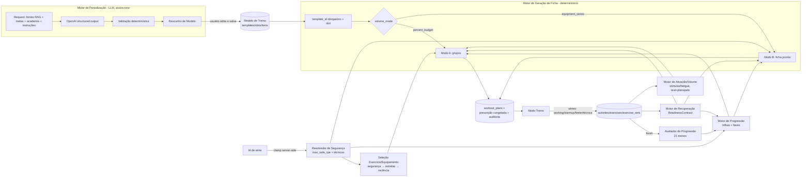

# Plano de Refatoração dos Motores MuscleFit (2026-09-12)

## Contexto e forma de execução

**Por quê:** o `c:\REFATORACAO_20260912.md` pede três mudanças. A progressão atual vira uma máquina de fases auditável. A geração diária passa a ser determinística e só executa um Modelo de Treino salvo. As divisões (ABC/PPL/Full Body) saem da geração e vão para um novo Motor de Periodização baseado em LLM. Tudo isso com capacidades de segurança por exercício/equipamento: RPE 10/falha, técnicas compatíveis e preferência por estrelas.

**Fonte de verdade:** o código atual. Divergências com `MUSCLE_FIT.md`, que tem 5.355 linhas e não 4.294, estão marcadas **[DIV]**. Os caminhos são relativos a `C:\muscle_fit`.

**Execução (regras do projeto):**
- O Tech Lead não codifica. Cada PR abaixo é delegado a um agente especialista: `fullstack` para backend/frontend, `aws` para Terraform/CI/migrações e `ai_engineer` para prompt/schema da Periodização.
- Todo PR usa `--base develop`. A branch de integração real se chama `develop`, e a memória será corrigida.
- A promoção para `main` só acontece depois da validação do usuário em DEV.
- Agentes em paralelo trabalham com `isolation: "worktree"`.
- Primeiro entregável depois da aprovação: este documento versionado em `docs/refatoracao-motores/PLANO_20260912.md` (PR docs → develop). Em seguida, os PRs da seção 15.

---

## 1. Resumo executivo

A refatoração real tem cinco partes:
1. **Trocar o motor de progressão.** Hoje é `suggest_load_and_reps`, stateless, olha 1 sessão, não filtra `set_type`, e o resultado é recalculado a cada leitura do plano. O novo motor é uma **máquina de fases persistida por trilha (usuário + exercício + equipamento)**, avaliada ao fim da sessão e congelada na ficha.
2. **Reduzir a geração diária a dois modos determinísticos sobre um template obrigatório.** Os modos já existem como `volume_mode`: `percent_budget` = Modo A e `equipment_series` = Modo B. Saem 4 caminhos com LLM: ABC, Full Body, template v1 e seletor v2.
3. **Criar a camada de segurança de treino que não existe:** catálogo de técnicas, `max_safe_rpe` e compatibilidade de técnicas, com default no equipamento e override em `equipment_exercises`. Mais preferência por estrelas por usuário.
4. **Criar o Motor de Periodização:** um job assíncrono que reaproveita a Lambda `musclefit-plan-generator` e gera um rascunho validado de template.
5. **Pagar dívida estrutural antes de mexer:** zero testes, migrações sem runner, bug de round-trip de campos avançados, aquecimento e séries de ajuste não persistidos, e dor zerada na projeção de recuperação.

**Maiores riscos:**
- Mudar prescrição sem testes de caracterização.
- Aplicar schema na Aurora sem mecanismo reproduzível.
- Defaults de segurança para dados legados: conservador pode "travar" técnicas existentes.
- Janela de compatibilidade de planos ABC/`split_day` históricos.
- Duas fontes de relação equipamento↔exercício (dual-write).

---

## 2. Mapa do estado atual

### 2.1 Geração de ficha
| Componente | Local | Papel | LLM |
|---|---|---|---|
| Dispatcher | `api/app/plan_generation_core.py:38` `dispatch_plan_generation` | `template_id` → equipment (L61) / v2 (L79, env `USE_TEMPLATE_VOLUME_ENGINE_V2`) / v1 (L98); `plan_type=="abc"` (L112); senão Full Body (L128) | — |
| ABC fixo | `api/app/abc_workout_template.py` (`ABC_TEMPLATE`, `next_abc_split_day` L498, `generate_abc_plan_draft` L534) | fallback do ABC IA | não |
| ABC IA | `api/app/abc_workout_ai.py:468` `generate_abc_plan_draft_ai`, prompt L236 | divisão ABC | sim |
| Reforço ABC | `api/app/abc_volume_reinforcement.py:121-206` | legado ABC | não |
| Full Body + biblioteca | `api/app/workout_plan_ai.py`: `build_fullbody_slots` L431, `build_prompt` L844, `generate_plan_draft` L1399, **helpers compartilhados** `gather_ficha_context` L134, `project_recovery_for_date` L203, `call_openai` L928, `reconcile_with_gym_catalog` L940, `assign_warmup_flags` L1192, `assign_progression_indicators` L1234, `cap_rpe_target_for_reduced_dose` L1272, `_extract_json` L1301 | Full Body (legado) + helpers | sim |
| Template v1 | `api/app/workout_plan_templates_engine.py`: `get_template_if_assigned` L56, `resolve_next_slot` L82, `generate_plan_draft_from_template` L497 | legado | sim |
| Template v2 (Modo A anterior) | **PR-13:** `api/app/generation/mode_a.py` (determinístico, sem LLM); o caminho anterior virou `api/app/generation/mode_a_legacy.py`, usado só com `GENERATION_ENGINE=legacy`. Referências históricas do arquivo antigo: `workout_plan_templates_engine_v2.py:178`; planner `intelligence/template_volume_planner.py:91,173`; `intelligence/template_volume_domain.py:148`; `intelligence/candidate_exercise_provider.py:32`; `intelligence/template_ai_selector_v2.py:21,103,141`; validador `intelligence/template_volume_validator.py` (`greedy_deterministic_selection` L748, `order_exercises_for_session` L727, `calculate_slot_activation` L74) | atual | sim, com fallback greedy |
| Equipment series (Modo B) | **PR-12:** `api/app/generation/mode_b.py` (determinístico, progressão v2, D13); o caminho anterior virou `api/app/generation/mode_b_legacy.py`, usado só com `GENERATION_ENGINE=legacy` | atual | não |
| Job assíncrono | `workout_plans.py:76` `POST /workout-plans/generate` → `async_jobs.create_job` (DynamoDB `musclefit-async-jobs`) → `lambda_plan_generator.py:36` → `GET /jobs/{id}` | — | — |
| Infra | `infra/lambda_ai_generators.tf:196-211` (plan-generator, 120 s, 1024 MB) | — | — |

### 2.2 Progressão (todas as "progressões")
| Componente | Local | Classificação |
|---|---|---|
| `suggest_load_and_reps` | `api/app/progression_service.py:107-299` | **motor de decisão** (único). Call sites: `abc_workout_template.py:670`, `abc_workout_ai.py:791`, `services.py:1388`, `services.py:2017`, `workout_plan_ai.py:1255` |
| `assign_progression_indicators` | `workout_plan_ai.py:1234`; chamado em `workout_plan_ai.py:1583`, `workout_plan_templates_engine.py:800`, `_v2.py:350`, `_equipment.py:418`, `services.py:2030` | adapter |
| `_enrich_plan_exercises_with_progression` | `services.py:1972-2034`, chamado por `get_workout_plan` `services.py:1968` | **recálculo na leitura** |
| `suggested_progression_for_mapping` | `services.py:1305-1416` (deriva `rpe_target` da média de RPE) | UI helper + regra paralela de RPE |
| `GET /exercises/suggested-progression` | `engines_extra.py:27` (Lambda engines, `infra/api_gateway.tf:146`); consumido em `PlanExecutionScreen.tsx:538,941`, `FreeformScreen.tsx:179`, `ExercisesTable.tsx:216` | UI helper |
| `classify_progression_trend` / `ProgressionService` | `intelligence/progression_service.py:89,189,221` | analytics |
| Dashboards | `analytics.py:1181,1210,1256,991`; `volume_service.py:2429`; `dashboard_alert_service.py:62,226`; front `dashboard/progressao/DashboardProgressaoClient.tsx`, `TrendBadge.tsx` | analytics |
| IA de série | `exercise_set_evaluation_ai.py` (prompt L92, parse L198); `POST /exercises/evaluate-set` `main.py:285` → `workout_ai_generation_core.py:36`; aplicado em `PlanExecutionScreen.tsx:1097-1144`, `FreeformScreen.tsx:522` | IA (sem clamp) |

### 2.3 Recuperação
- `intelligence/muscle_recovery_service.py`:
  - estados READY/REDUCED_DOSE/NO_DIRECT_WORK (L71-99: `maximum_rpe` 10/9/8, `allow_failure_on_last_set`, multiplicador 1/0,75/0);
  - `classify_readiness` L285;
  - fatores por `set_type` L54-69;
  - `failure_penalty` L186;
  - `muscle_recovery_coefficients` só lida (L390).
- A dose vem de `VolumeService.get_muscle_group_overview` (`volume_service.py:567-931`), com a dor do rollup `exercises` (só PRIMARY, só a última sessão).
- **A projeção futura zera dor e sinais** em `workout_plan_ai.py:257-269`.
- Endpoints (engines): `/analytics/muscle-recovery`, `-consecutive-check`, `dashboard-recovery`, `dashboard-muscle-status` etc.

### 2.4 Equipamentos
- **Tabelas:** `equipment` (001:178; colunas `equipment_type_id, manufacturer, model, location` só na Aurora **[DIV]**), `equipment_exercises` (002:120, **fonte de runtime**), `equipment_exercise_mappings` (001:254, **fonte de escrita** com dual-write `gyms.py:1274/1293`), `gym_equipment_catalog`, `gym_equipment` (cache materializado por `gym_equipment_sync.py:26-82`), `exercise_catalog` (+`is_compound`), `exercise_muscle_contributions` (005: `exercise_id, muscle_group_id, role, stimulus_weight, fatigue_weight`).
- **Recomendador:** `gyms.py:922` `/gym-equipment/recommend` e `:1058` `/recommend-all`. `ORDER BY last_used IS NULL DESC, last_used ASC, name`; `last_used` **sem filtro de usuário**.
- **Consumidores do recomendador:** `workout_plan_ai.py:173` (`gather_ficha_context`), `abc_*`, v1, v2 (`candidate_exercise_provider`), equipment (`_recommend_for_group`), `services.resolve_equipment_id` (`services.py:218`), front `AcademiasClient.tsx:100`, `EquipmentSubstituteModal.tsx:81`.
- **Tipos duplicados:** `gyms-types.ts:57-86` (`RecommendItem`) e `workout-mode-types.ts:391-412` (`GymEquipmentRecommendItem`).
- **Inexistentes:** estrelas, incremento de carga, compatibilidade técnica e `max_safe_rpe`. `equipment_exercises.is_preferred` existe mas é morto.

### 2.5 Metas / training_types
- **Tabelas:** `training_types`, `training_type_muscle_group_targets` (010), `rag_folder` (015).
- **CRUD:** `training_types.py`.
- **Consumidores:** `template_volume_planner.py:107,268`, `volume_service.py:1254-1325`, `analytics.py:769-890`, `dashboard_alert_service.py`.
- **Frontend:** `/tipos-treinamento` (3 arquivos), menu `AppShellLayout.tsx:400`, `infra/cloudfront-functions/spa-index-rewrite.js`, `tools/onprem-sync/sync.py`.

### 2.6 Técnicas avançadas / RPE / usuário avançado
- **Técnicas:**
  - Backend: `Literal` com 8 valores só em `models.py:293-304`.
  - Frontend: `workout-plan-templates-types.ts:33,289` e `lib/advanced-techniques.ts:28-78` (técnica→`set_type`).
  - Não há catálogo.
- **`set_type`:** livre (`models.py:10`), com `dropset`/`drop_set` duplicados.
- **RPE prescrito em muitos lugares:** `workout_plan_ai.py:808,1369,1272`, `abc_*:618/748`, equipment `"8"` (L381), v1/v2 `"8-9"`, `services.py:1376`.
- **Default de RPE 10 fixo no modo avançado:** `PlanExecutionScreen.tsx:1315`.
- **`is_advanced_user`** (`user_flags.py:14`) relaxa em `progression_service.py:184` e `volume_service.py:585,843-852`.

### 2.7 Execução, persistência e histórico
- **Endpoints:** `workout_sessions.py` (start L256, exercises L387 com `workout_plan_exercise_id`, sets L446 com dor por série, finish L509).
- **Persistência de aquecimento/ajuste:** ficam só no localStorage (`PlanExecutionScreen.tsx:640-740`, `workout-mode-types.ts:165`).
- **Colunas ausentes em `exercise_sets`:** `rpe_target`, técnica, pico.
- **Histórico de "21 treinos":** não existe; o mais próximo é `services.list_exercise_logs` (`services.py:869`, limite por linha e N+1) e `VolumeService._fetch_full_history_sets` (`volume_service.py:210`).

### 2.8 Infra, schema, testes
- **API Gateway:** `infra/api_gateway.tf` com `{proxy+}` → api-core; rotas engines enumeradas em `locals` L97-148. Rota nova no core não exige Terraform.
- **Migrações:**
  - `api/db/migrations/001–021.sql` só no init do Docker; `schema_migrations` sem runner, com versões que não batem com os arquivos.
  - Na Aurora: `_ensure_schema` lazy (`schema_guards.py:37`) ou nada.
  - `backend-deploy.yml` não migra. (Retrato da época; esse workflow foi removido no PR #67 e o deploy hoje é `deploy-producao.yml`.)
  - **[DIV]** `MUSCLE_FIT.md:488` diz que não há migrations.
- **Testes:** nenhum em `api/` nem `frontend/`. CI `ci-develop.yml`: typecheck, `py_compile`, smoke Docker e `pytest` condicional no-op.
- **RAG:** `rag/markdown/*` + `TIPOS_TREINO/{1. Full Body,2. ABC}`, via `rag_chunking.py:598` `select_rag_text`, com fallback que mistura todos os tipos. `TECNICAS_AVANCADAS.md` (nome real; `_RAG` é só o título interno) **não é carregado por código**.
- **OpenAI:** `openai_client.py:17` (Responses API, sem structured output, parse por regex); `OPENAI_MODEL_PLAN` no Terraform nunca lido **[DIV]**.

---

## 3. Gaps e inconsistências

| # | Tipo | Item | Classe |
|---|---|---|---|
| G1 | bug atual | Os saves de ficha descartam os 10 campos avançados + `muscle_group_id`/`template_slot_id`; o PUT em `PlanDetailClient.tsx:~190` **apaga** valores persistidos. `WorkoutPlanExerciseInput` (`workout-plans-types.ts:92`) não tem esses campos. Saves em `GenerateDraftModal.tsx:200`, `ModeSelectScreen.tsx:173` | BLOCKER |
| G2 | bug atual | `suggest_load_and_reps` usa `sets[-1].weight_kg` sem filtrar `set_type`: um drop-set rebaixa a carga base | IMPORTANT |
| G3 | bug atual | `project_recovery_for_date` zera `joint_pain`/`muscle_pain`/sinais para qualquer alvo futuro, inclusive o mesmo dia com `plan_time` | BLOCKER |
| G4 | bug atual | REDUCED_DOSE grava "sem progressão" e em seguida o motor sugere +5% (`abc_workout_template.py:615/669`, `abc_workout_ai.py:743/791`) | CLEANUP (morre com ABC) |
| G5 | bug atual | `last_used_at` do recomendador não filtra usuário (`gyms.py:1035,1123`) | IMPORTANT |
| G6 | bug atual | Default de RPE 10 fixo no modo avançado (`PlanExecutionScreen.tsx:1315`); a IA de série sobrescreve alvos sem clamp (`:1097`) | BLOCKER (segurança) |
| G7 | bug atual | `preview-activation` projeta o ciclo em 7 dias fixos; slots além do 7º somem (`workout_plan_templates.py:~880`) | IMPORTANT |
| G8 | comportamento incompatível | `get_workout_plan` recalcula progressão na leitura (`services.py:1968`) | BLOCKER |
| G9 | comportamento incompatível | Geração sem `template_id`: `GenerateDraftModal` (template opcional) e `ModeSelectScreen.tsx:147` (nunca envia) → ABC/Full Body | BLOCKER |
| G10 | comportamento incompatível | Modo B substitui equipamento indisponível **por grupo** (pode trocar o exercício) (`_equipment.py:147`) | DECISION |
| G11 | comportamento incompatível | `is_advanced_user` relaxa penalidades de RPE 10 precoce; decisão de 2026-09-14 (D4): essas penalidades são removidas **para todos** (progressão e recuperação) | IMPORTANT |
| G12 | comportamento incompatível | LLM escolhe exercícios no v1/v2/ABC/Full Body | IMPORTANT |
| G13 | dado inexistente | Estrelas, `max_safe_rpe`, técnicas compatíveis, catálogo de técnicas, incremento de carga, estado de progressão, decisões auditáveis | BLOCKER |
| G14 | dado inexistente | Aquecimento/ajuste não persistidos (localStorage); pico de contração não persistido na execução | IMPORTANT |
| G15 | dado inexistente | Não existe query de "últimos N treinos" com séries, `set_type`, dor por série e vínculo de ficha | IMPORTANT |
| G16 | dado inexistente | Técnica/pico não contam na ativação (`workout_plan_templates.py:784`, 017 comentário) | DECISION |
| G17 | dado inexistente | Não há ordenação por fadiga; `fatigue_weight` não é usado na geração | IMPORTANT |
| G18 | contrato duplicado | Relação equipamento↔exercício em duas tabelas com ids distintos (`EquipmentLinksSection.tsx:29-96` contorna) | IMPORTANT |
| G19 | contrato duplicado | Listas de técnicas em backend `Literal` + 3 lugares no front; `set_type` livre com `dropset`/`drop_set` | IMPORTANT |
| G20 | contrato duplicado | Tipos de recomendação duplicados no front; `rpe_target` derivado em 4+ regras diferentes | CLEANUP |
| G21 | contrato duplicado | `priority_min/max_pct` de slot (011) validado e nunca consumido | CLEANUP |
| G22 | risco de migração | Sem runner; `schema_migrations` inconsistente; Aurora com colunas fora do repo (`equipment_types`, `equipment.*`); FK de `equipment_exercise_mappings` na Aurora não confirmada; suporte a `PREPARE` no shim Data API **não verificado** | BLOCKER |
| G23 | risco de migração | Histórico `plan_type='abc'`/`split_day`; `template_type`; `raw_payload` antigo; rota `/analytics/training-volume-by-split-day` (engines, sem consumidor no front) | IMPORTANT |
| G24 | risco | Zero testes automatizados de aplicação | BLOCKER |
| G25 | requisito ambíguo | Fases 3 e 4 com o mesmo gatilho; "mais de uma semana"; fase por grupo vs carga por exercício; incremento; F5 multi-exercício; técnica na F4; semântica de RPE proibido; dono de séries/reps/carga (Modo A) | DECISION (resolvidas em §5–6, confirmar §16) |
| G26 | a verificar | `template_volume_planner` busca `/analytics/muscle-recovery` via token mestre, possivelmente **sem filtro de usuário** (`_equipment.py:319-322`); `rpe_anticipated` usa `raw_payload.workout_plan_id` e não `activities.workout_plan_id` (`volume_service.py:239`) — ambos confirmados e corrigidos no PR #53; `weight_kg` de halteres: **total** (D12) | IMPORTANT |
| G27 | cleanup | `OPENAI_MODEL_PLAN` não lido; `tests/test_candidate_exercise_provider.py` citado e inexistente; `equipment_exercises.is_preferred` morto; `_ensure_workout_plans_split_day_column` (`services.py:1735`) | CLEANUP |

---

## 4. Arquitetura alvo



**Responsabilidades e ownership:** a hipótese do documento foi validada, com ajuste na ambiguidade 3.1.10.

- **Modelo:**
  - Estrutura, slots, grupos e %.
  - No Modo B: exercício/equipamento, séries, descanso, técnica, aquecimento, ajuste e pico.
  - `rpe_target` pedido no Modo B é tratado como **intenção**, sujeita a clamp.
- **Ativação:**
  - Orçamento de ativação por grupo no slot, usando as metas + o executado na janela + o planejado restante.
  - Decide **quantos exercícios/séries totais** o grupo precisa.
- **Recuperação:** readiness, sinais de dor e limites de dose/intensidade (`volume_multiplier`, `max_rpe`, `allow_failure`). **Não** define séries, reps ou carga. Corrige a especificação original, ponto a confirmar em D6.
- **Progressão:**
  - Por trilha: faixa de reps, carga, séries por exercício (até 4) e técnica introduzida pela progressão.
  - Transições e cadência.
- **Segurança:** `resolve_training_safety(exercise_id, equipment_id)` → `max_safe_rpe`, `failure_allowed`, técnicas permitidas e origem da regra. Função **única**; frontend, IA e analytics só consomem os campos.
- **Seleção:** filtra por disponibilidade e segurança, depois ranqueia por estrelas, recência do usuário e nome, com deduplicação.
- **Geração:** orquestra, congela a prescrição e grava a auditoria. Nunca decide a divisão.

**Composição de intensidade (regra única, `api/app/domain/training_safety.py`):**
```
ceiling  = min(safety.max_safe_rpe, recovery.max_rpe)          # 10/9/8 recovery; NULL safety → 9 (D3)
failure_allowed = ceiling == 10 and recovery.allow_failure
target   = min(prescribed_target_or_default, ceiling)
clamps[] = registros {field, from, to, reason: EQUIPMENT_SAFETY|RECOVERY|LEGACY_PLAN|AI_SUGGESTION}
```
`is_advanced_user` **não** entra nessa função.

---

## 5. Novo Motor de Progressão

### 5.1 Unidade de estado (resolve a ambiguidade C/D) — **decidido em D2: fase por grupo muscular**
- **Estado de fase do grupo = `(user_id, muscle_group_id)`**. Pertencem ao grupo:
  - `phase` (F1–F6), `pending_action`, `phase_entered_at`;
  - datas das transições (`last_rep_range_change_at`, `last_load_change_at`, `last_sets_change_at`, `technique_applied_at`);
  - `next_eligible_progression_at`.
  - A **faixa de reps** vem da fase do grupo (F1 = 6–8; F2+ = 10–12, D1).
- **Trilha = `(user_id, exercise_id canônico, equipment_id canônico)`**, com `equipment.id` e não `gym_equipment.id` (cache por academia). A trilha é dona do que é físico do exercício/equipamento:
  - `working_load_kg`, `sets_count`, `technique_code`;
  - status de calibração;
  - datas da última mudança de carga/séries **daquela trilha**.
- **Pertinência trilha → grupo:** o grupo **PRIMARY** do exercício (`exercise_muscle_contributions.role='PRIMARY'`). Contribuições SECONDARY/STABILIZER não participam da fase do grupo; seguem valendo para ativação e recuperação.
- **Carga nunca é compartilhada entre trilhas.** Supino máquina, supino halteres e peck deck compartilham a **fase** do grupo Peito, mas cada um tem sua carga.
- **Troca de exercício/equipamento dentro do grupo:** a fase do grupo é preservada; a trilha nova entra em `CALIBRATION` para carga (é a vantagem do D2).
- **Consequência aceita:** uma trilha atrasada segura a fase do grupo inteiro (§5.4).

### 5.2 Entradas
1. `TrainingHistoryRepository.fetch_last_completed_sessions(user_id, n=21)` (novo, `api/app/domain/training_history.py`).
   - Consulta: `activities` (finalizadas) ⋈ `exercises` ⋈ `exercise_sets` ⋈ `workout_plan_exercises` (via `exercises.workout_plan_exercise_id`), com query única e sem N+1.
   - DTO por série: `set_type, reps, weight_kg, rpe, muscle_pain, joint_pain`.
   - DTO por exercício: `exercise_id, equipment_id (via gym_equipment), prescribed{sets,reps_min,reps_max,load,rpe_target,technique}, prescription_snapshot_id`.
2. `progression_tracks` (estado persistido).
3. `ReadinessContract` por grupo, projetado para `target_datetime` (§5.8).
4. `SafetyCapabilities` do par (§4).
5. `exercise_catalog.is_compound`, `equipment.load_increment_kg`, perfil de usuário (`experience_level`, D11).

### 5.3 Classificação de séries (resolve 7.10)
| `set_type` | Progressão | Recuperação/ativação |
|---|---|---|
| `working` | **conta** (carga, reps, RPE) | fator 1,00 |
| `warmup` | ignora | 0,10 (já existe) |
| `feeler` (série de ajuste) | ignora | 0,20 |
| `rest_pause`, `drop_set`, `forced_rep` (aplicações de técnica) | evidência de "técnica aplicada"; **nunca** é carga base | fatores atuais |
| `dropset` (legado) | normalizado para `drop_set` na leitura | 1,15 |
| outros/desconhecido | ignora + evidência `unknown_set_type` | 1,0 |

A carga executada da sessão é o **mínimo das cargas das séries `working`**. É conservador: garante que "com a carga proposta" valeu para todas.

### 5.4 Sessão qualificante (predicado único)
**Nível trilha.** Para uma trilha com estado `(reps_min, reps_max` da fase do grupo`, load L, sets S)`, a trilha qualifica na sessão quando:
- nº de séries `working` ≥ S;
- todas as `working` com `weight_kg ≥ L` (trilha sem carga: ignora);
- **todas** as `working` com `reps ≥ reps_max`, isto é, teto **alcançado ou superado** em todas as séries (D4 revisada em 2026-09-14);
- **só a última** série `working` (na ordem de execução, ignorando aquecimento, ajuste e aplicações de técnica) com `RPE ≥ alvo_efetivo`, onde `alvo_efetivo = min(rpe_target prescrito para o exercício naquela sessão, ceiling)` — **D4 revisada em 2026-09-18**. As séries anteriores **não** precisam atingir o alvo de RPE: é assim que se treina, as iniciais ficam abaixo de propósito. O teto seguro (`ceiling`) só corta o alvo **para baixo**; nunca exige nada;
- `rpe_target` é uma **rampa por série** no banco (`"8-9-10"`): o alvo de esforço é o **último degrau**. Sessão sem alvo prescrito (treino avulso, histórico legado) usa `DEFAULT_EFFORT_TARGET_RPE = 8`, também clampado pelo teto;
- o critério é parametrizado (`EFFORT_TARGET_SCOPE`): voltar a exigir o alvo em **todas** as séries é uma linha;
- RPE 10 em qualquer série, inclusive antes da última, **não** bloqueia nem penaliza a progressão;
- sem dor bloqueante no exercício/grupo daquela sessão: `joint_pain` = true bloqueia; `muscle_pain ≥ 4` bloqueia; `NULL` = não reportado = não bloqueia (D5).

**Sessões neutras** (não qualificam e não zeram a sequência): readiness da sessão ≠ READY, RPE ausente, dor reportada, sessão executada com séries < S por decisão de dose.

**Sessões que zeram a sequência:** qualquer outra sessão da trilha que não qualifica.

**Nível grupo (D2).** Numa sessão, o grupo é avaliado sobre as trilhas desse grupo PRIMARY executadas nela:
- **Qualifica** se todas as trilhas não neutras qualificam e existe ≥ 1 trilha não neutra.
- **Neutra** se todas as trilhas são neutras. Trilhas em `CALIBRATION` são neutras.
- **Zera a sequência** do grupo se qualquer trilha não neutra deixa de qualificar.
- O grupo sem execução na sessão não é avaliado.

### 5.5 "Mais de uma semana" (resolve B)
Um **platô do grupo é confirmado** quando existem ≥ 2 sessões **de grupo** qualificantes consecutivas (neutras ignoradas) desde `phase_entered_at`/última ação efetivada, e `data(última) − data(primeira da sequência) ≥ 7 dias`.

Por quê: funciona com qualquer frequência (1× ou 3× por semana), exige repetição real e não é enganado por duas sessões no mesmo dia. "Critério mantido em todas durante ≥ 7 dias" vira caso particular.

### 5.6 Máquina de fases (resolve A, H, I, Q, R)
A fase e a `pending_action` são **do grupo** (D2). A ação é aplicada **às trilhas do grupo** conforme a coluna "Ação":
- **Mudança de faixa** (F2): vale para todas as trilhas do grupo.
- **Aumento de carga** (F3/F6): vale para cada trilha do grupo, na próxima vez que ela for prescrita. Cada trilha registra a efetivação; o grupo considera a ação efetivada quando todas as trilhas ativas do grupo a executaram ou após 14 dias, o que ocorrer primeiro.
- **Técnica** (F4) e **+1 série** (F5): aplicadas a **uma** trilha do grupo por platô:
  - técnica: a última trilha do grupo na ordem da sessão com interseção de técnicas não vazia (RAG: técnica no último exercício do grupo);
  - série: a trilha com maior `stimulus_weight` PRIMARY e `sets_count < 4`; empate pela ordem na sessão.
- **F6:** o grupo entra em F6 quando todas as trilhas ativas do grupo têm 4 séries, ou quando a próxima série ultrapassaria o `max_weekly` de ativação do grupo (`blocked_by=ACTIVATION_MAX`).
- **Trilha ativa do grupo:** executada nas últimas 21 sessões.

**O avaliador roda no `finish` da sessão** e só grava `pending_action`. A ação vira efetiva quando uma sessão prescrita com ela é concluída. Assim um rascunho descartado não avança fase, e F3 e F4 nunca disparam juntas, porque cada platô avança **um degrau**.

| Fase | Pré-condição de entrada | Ação prescrita | Transição (platô confirmado) | Bloqueios |
|---|---|---|---|---|
| F1 | grupo sem estado (primeira sessão do grupo) | reps 6–8, carga L de cada trilha, S séries da trilha (default 3), RPE alvo = `min(alvo prescrito, ceiling)` | platô com teto 8 → `pending=SET_REP_RANGE_10_12` → F2 | readiness≠READY, dor, RPE ausente (RPE 10 precoce **não** bloqueia) |
| F2 | ação F1 efetivada | reps 10–12, mesma carga | platô com teto 12 → `pending=INCREASE_LOAD` → F3 | idem |
| F3 | carga aumentada (faixa **permanece 10–12**, D1) | reps 10–12, L+Δ | novo platô em 12 → `pending=APPLY_TECHNIQUE` → F4 | idem + `load_not_applicable` (trilha sem carga pula para F4) |
| F4 | técnica escolhida (§5.9) | 10–12, L, técnica T na última série | platô com técnica → F5 | interseção de técnicas vazia → F4 `SKIPPED_NO_ELIGIBLE_TECHNIQUE`, segue para F5 com a condição "técnica aplicada" considerada satisfeita (D8) |
| F5 | técnica ativa/pulada, S < 4 | +1 série (S+1 ≤ 4) | platô → +1 série até 4 → F6 | teto de ativação semanal do grupo (a série vai para a trilha de maior `stimulus_weight` PRIMARY no grupo; empate pela ordem na sessão); **Modo B: séries fixas pelo modelo** → `blocked_by=MODEL_FIXED_SETS`, gera recomendação de edição e segue para F6 (D9) |
| F6 | S = 4 | 10–12, 4 séries, técnica | platô **e** `now ≥ last_load_change_at + 14 d` → `INCREASE_LOAD` (permanece F6) | idem + `next_eligible_progression_at` |

**Quando os critérios não são satisfeitos:** mantém a prescrição (decisão `HOLD`).

**Regressão** (a especificação não pede; proposta D10): se 2 sessões `working` consecutivas não qualificantes ficam abaixo de `reps_min` com a carga L e sem dor, `pending=DECREASE_LOAD` em um incremento, sem mudar a fase. Substitui o −5% atual por RPE 10 precoce, que é **removido**: RPE 10 antes da última série não gera `HOLD`, redução de carga nem evidência negativa (decisão de 2026-09-14).

**Incremento (G):**
- `Δbase` = 5 kg se `exercise_catalog.is_compound`, senão 2,5 kg.
- `step = equipment.load_increment_kg` (NULL → 2,5).
- `Δ = max(Δbase, step)` arredondado para múltiplo de `step`.
- Se `Δ > 5` → evidência `increment_exceeds_rule`.
- Halteres (D12): `weight_kg` é sempre **total**; `step` também é total (ex.: halteres de 1 kg em 1 kg por mão → `load_increment_kg = 2`). Não há conversão por lado.

### 5.7 Semântica de RPE 10 proibido (resolve Q)
Com `failure_allowed=false`:
- `rpe_target` prescrito é clampado pelo `ceiling` (`min(prescrito, ceiling)`); a ficha nunca mostra 10.
- A intensidade exigida é o **alvo prescrito clampado**, cobrada **só na última série `working`** (D4 revisada em 2026-09-18). O `ceiling` é limite superior, **não** exigência: alvo prescrito 8 num par com `max_safe_rpe=10` exige 8, não 10. Onde a falha é proibida e o alvo prescrito é 10, o clamp baixa a exigência para 9 e **RPE 9 satisfaz integralmente**.
- RPE 8 na última série com alvo 9: não qualificante (motivo `rpe_below_target`) e **não pune**. Não reduz carga e só zera a sequência se RPE estiver presente e o resto da sessão não for neutro. A UI mostra "abaixo do alvo seguro".
- RPE 10 registrado: vale como intensidade atingida (clamp lógico para o ceiling). Gera `safety_event{type:"RPE_ABOVE_SAFE_CEILING"}`, mostrado na UI e contado em métrica. **Nunca** eleva o alvo futuro.
- Ceiling < 9 (ex.: safety 8): o alvo cai para 8 e exige-se RPE ≥ 8 **na última série**. Sessões em REDUCED_DOSE continuam neutras (§5.8).
- Analytics e dashboards exibem `intensity_status ∈ {REACHED, BELOW_TARGET, FAILURE_NOT_ALLOWED_REACHED_CEILING, ABOVE_SAFE_CEILING}`.

### 5.8 Contrato de Recuperação (resolve F e 7.3)
```json
{"muscle_group_id": 3, "projected_for": "2026-09-15T07:00:00-03:00",
 "status": "REDUCED_DOSE", "readiness_pct": 68,
 "max_rpe": 9, "allow_failure": false, "volume_multiplier": 0.75,
 "blocking_signals": [{"code":"MUSCLE_PAIN","value":5,"source_session_at":"2026-09-12T18:10:00-03:00"}],
 "signals_policy": "pain_persists_until_superseded"}
```

**Política nova de projeção** (substitui `workout_plan_ai.py:257-269`):
- Dor articular e muscular **persistem** até uma sessão posterior do mesmo grupo sem dor reportada (D5).
- Sinais de performance (`rpe_anticipated`, `excessive_rep_drop`, `performance_ratio`) decaem quando o alvo está ≥ 72 h à frente, alinhado à janela de densidade.

**Efeito na progressão:**

| Status | Efeito |
|---|---|
| READY | a `pending_action` pode ser prescrita |
| REDUCED_DOSE | prescreve a ação **anterior** (`transition_deferred`), séries = `ceil(S × 0,75)` (mín. 1), sem técnica, ceiling ≤ 9; sessão neutra |
| NO_DIRECT_WORK | a trilha retorna `decision=SKIP` (sem prescrição); a geração exclui o grupo como trabalho direto |

A progressão consome **só o contrato**, sem sinal bruto; os sinais vão em `evidence`.

### 5.9 Técnicas (resolve I, J, R, 7.8)
**Taxonomia** (tabela `advanced_techniques`, seed a partir de `rag/markdown/TECNICAS_AVANCADAS.md` TEC-001..036):

| code | failure_requirement | requires_partner | auto_applicable | set_type | min_experience |
|---|---|---|---|---|---|
| rest_pause | requires_failure | não | **sim** | rest_pause | intermediate |
| drop_set | requires_failure | não | **sim** | drop_set | intermediate |
| fst7 | requires_failure | não | não (7 séries conflita com teto 4) | working | advanced |
| gvt | failure_not_required (clássico) | não | não (volume 10×10) | working | intermediate |
| forced_reps | beyond_failure | **sim** | não (parceiro não modelado) | forced_rep | advanced |
| negative_reps | beyond_failure | sim | não | forced_rep | advanced |
| partial_reps | beyond_failure | não | não | forced_rep | advanced |
| cheat_reps | beyond_failure | não | **nunca** (TEC-033) | forced_rep | advanced |

**Elegíveis** = `técnicas_permitidas(par)` ∩ `{failure_requirement ∈ failure_not_required ∪ (requires/beyond se failure_allowed)}` ∩ `auto_applicable` (só para a progressão) ∩ `readiness=READY e sem dor` ∩ `experience ≥ min_experience` ∩ `sem outra técnica fixada`.

**Validação defensiva:** técnica com `requires_failure`/`beyond_failure` num par `failure_allowed=false` é inválida **mesmo** se marcada compatível na matriz.

**Ordem determinística da F4:** `rest_pause` > `drop_set`. A interseção vazia é tratada na tabela da §5.6.

**Hierarquia de autoridade** (uma técnica por exercício): Modelo (Modo B, técnica fixa) > Progressão (F4+) > nenhuma.
- Técnica da progressão ignorada por técnica fixa no modelo → `evidence: TECHNIQUE_OVERRIDDEN_BY_MODEL`.
- Técnica fixa inválida pela segurança → removida da prescrição + warning na ficha + auditoria. O modelo continua salvo; o builder mostra o erro (§6.2).
- Modo avançado/`set_type` no modo treino: executa apenas a técnica prescrita.
- Terminal: `training_safety.validate_technique()`.

**Técnica e ativação (7.7/G16):** a técnica **não corrige subativação** nesta refatoração. `advanced_techniques.activation_set_equivalent` é criado com default 0 e o Motor de Ativação passa a somá-lo (histórico via `set_type`, planejado via técnica), para ligar isso depois de calibrado (D7). Déficit no Modo A é corrigido só com séries/exercícios.

### 5.10 Casos de borda
| Caso | Comportamento |
|---|---|
| Exercício/trilha nova | trilha em `CALIBRATION` (neutra para o grupo): reps = faixa da fase **atual do grupo**, carga `null` (UI pede carga que atinja o alvo); 1ª sessão define L = mín. das `working`. Grupo sem estado nasce em F1 |
| Treino avulso sem plano | conta para a trilha se `exercise_id`+`equipment_id` resolvidos; carga proposta = L da trilha |
| Ausência de carga (peso corporal) | trilha `load_applicable=false`: F3/F6 viram `SKIPPED_LOAD_NOT_APPLICABLE` |
| Plano legado com `rpe_target=10` em par proibido | prescrição congelada não muda; **overlay de segurança** ao vivo no modo treino mostra o ceiling (só restringe) + clamp auditado |
| `is_advanced_user=true` em par proibido | a restrição vale; a flag não participa de segurança |
| Troca de exercício no modo treino | as séries são gravadas na trilha do par realmente executado |
| Histórico só com agregados (antigo, sem `exercise_sets`) | ignorado para platô; o bootstrap usa só sessões com séries |

### 5.11 Persistência e saída
**Persistência:** estado **persistido** em `progression_group_states` (fase, por grupo) e `progression_tracks` (carga/séries/técnica, por exercício+equipamento) + eventos em `progression_decisions`.

**Ajustes de implementação registrados no PR-10 (2026-09-18):**

- **Onde o motor mora.** As funções puras ficaram em `api/app/domain/progression_engine.py` (classificação, predicados, fases, incremento, técnicas, `ProgressionDecision`) e `api/app/domain/progression_evaluator.py` (o `on_session_finish` e o replay, ainda sem banco). A persistência e a flag ficaram em `api/app/progression_state.py`, e as rotas em `api/app/progression.py`. Motivo: manter a matriz da §13 inteira sobre funções puras.
- **Regressão (D10) não tem coluna própria.** O pseudocódigo desta seção guarda a regressão em `track.pending_load_action`, mas a §8.2 não cria essa coluna. Implementado como `progression_group_states.pending_action = DECREASE_LOAD` com `pending_payload = {"track_key": [exercise_id, equipment_id], "rule": "D10"}` — a carga continua sendo da trilha (o payload diz qual), e a fase **não** muda, como a §5.6 exige. Motivo: cabe no schema aprovado sem migração extra.
- **Estado usado no julgamento.** Uma sessão é julgada com o estado da trilha **anterior** à execução (a carga L e o nº de séries S com que ela foi de fato prescrita); a **efetivação** da ação pendente usa o estado posterior, porque é a execução que a efetiva. Sem essa separação, "trilha em calibração é neutra" não valeria na própria sessão que a calibra.
- **`intensity_status` de RPE 10 proibido.** `ABOVE_SAFE_CEILING` vence os outros status quando **qualquer** série registra RPE 10 num par sem falha permitida (a qualificação continua olhando o RPE da última série `working`, D4 revisada em 2026-09-18). Motivo: é o que a UI mostra e a métrica conta (§5.7).
- **Teto de ativação semanal (`ACTIVATION_MAX`).** Entra como parâmetro `activation_max_reached` do avaliador, porque o Motor de Ativação só é ligado à progressão no PR-13. Em modo sombra chega sempre `False`.
- **Contrato de Recuperação em modo sombra.** A avaliação do `finish` é retroativa (a sessão já aconteceu) e o contrato da §5.8 é projetado para um instante **futuro**; por isso o avaliador em sombra usa `READY` para todos os grupos e quem prescreve (PR-11/12/13) passa o contrato projetado. `ReadinessContract.from_projection` já lê a saída de `intelligence/recovery_projection.py`.
- **Flag `PROGRESSION_ENGINE`.** Aceita `v1|shadow|v2`; o default é **`v1`** (desligado) e produção não define a variável, então o deploy do PR-10 não muda comportamento nenhum. DEV liga `shadow` pelo `docker-compose.yml` — a flag **não** existe em `infra/` (teste garante).

**Correção de produção registrada em 2026-09-19 (carga executada e teto de séries):**

- **A trilha adota a carga executada (`load_adopted_from_execution`).** No desenho original a carga da trilha só mudava por decisão da progressão (`INCREASE_LOAD`/`DECREASE_LOAD`), mas **nenhum caminho escrevia `working_load_kg`** fora da calibração — nem a efetivação do `INCREASE_LOAD`. Resultado em produção: a trilha ficava presa na carga da primeira sessão (usuário 1, exercício 27: ficha com 35 kg contra 50 kg executados, −30%). Regra implementada em `progression_evaluator.update_track_execution` + `progression_engine.adopted_working_load`: quando a carga executada da sessão (o **mínimo das `working`** da §5.3, portanto todas as séries de trabalho mais pesadas que `working_load_kg`) é maior que a carga da trilha, a trilha **adota** a carga executada, grava `last_load_change_at` e a decisão registra `evidence.load_adopted_from_execution = {"<ex>:<eq>": {from_kg, to_kg, source}}`. Não adota quando a trilha está em calibração ou sem carga aplicável, nem quando **todas** as `working` ficaram abaixo de `reps_min` (território da D10 — adotar consolidaria uma carga alta demais). **Reduções continuam exclusivamente com a D10** (`DECREASE_LOAD`), que existe para não derrubar carga por um dia ruim: a assimetria é deliberada. Princípio: o motor nunca prescreve menos do que a pessoa acabou de levantar sem um motivo explícito e auditável. Séries de técnica (`drop_set`, `rest_pause`) continuam fora da carga base (bug G2), porque a adoção só olha as `working`.
- **`sets_count` respeita o teto de 4 da §5.6.** `update_track_execution` copiava o número de séries executadas sem teto: uma sessão com 6 séries `working` deixou a trilha com `sets_count = 6` (trilha 261 em produção), acima do que a F5 pode chegar. Efeito colateral grave: toda sessão seguinte com menos séries virava NEUTRA por `sets_below_prescribed_dose`, e a trilha não podia mais qualificar, zerar a sequência nem regredir. Agora o valor adotado da execução é `min(séries working, MAX_SETS_COUNT)`.
- **O teto de 4 vale para qualquer ORIGEM do `sets_count` da trilha (2026-09-19, segunda correção).** O teto acima cobria só o caminho da execução, e sobraram 5 trilhas congeladas em produção (usuário 1: 441 com 9, 464 com 5, 522 com 5, 523 com 9, 535 com 9). A origem delas é a **prescrição**: `progression_evaluator.track_for` criava a trilha com `execution.prescribed.sets` sem teto, e fichas geradas entre 2026-08-23 e 2026-09-07 pelo caminho legado (`engine_version` nulo, geração por LLM) traziam 5, 6 e 9 séries — a IA tratou o `percent_budget` de um item de **grupo muscular** do modelo (Modo A: orçamento do grupo no slot, para distribuir entre 2–3 exercícios) como séries de um único exercício. Os modelos do usuário estão corretos. Regra: `sets_count` da trilha **nunca** excede `MAX_SETS_COUNT`, venha da execução, da prescrição ou da linha já persistida — fonte única `progression_engine.clamp_sets_count`, aplicada em `progression_evaluator.track_for` e `update_track_execution` e em `progression_state.load_tracks`/`save_track` (a leitura clampada descongela as trilhas antigas antes do replay). O excedente que a ficha prescreve é **volume extra legítimo**: a qualificação passa a exigir as 4 séries da trilha e séries além disso não atrapalham. O predicado da §5.4 **não muda** (continua exigindo `≥ S`); o que passa a respeitar o teto é o `S`. **Não viola a D9:** o único ponto onde o `sets_count` pode passar de 4 é `generation/deterministic_prescription._track_for`, onde a trilha é só o transporte das séries do modelo para `prescribe` e não é persistida — no Modo B a ficha continua com as séries do modelo e a F5 continua devolvendo `HOLD` + `blocked_by=MODEL_FIXED_SETS`.

- **Retenção D15.** `progression_state.retention_cleanup()` apaga decisões com mais de 18 meses e está exposta em `rebuild_progression_tracks.py --cleanup`. O agendamento fica para o PR-20. **Script de replay** (`api/scripts/rebuild_progression_tracks.py`) reconstrói as trilhas a partir do histórico. Modelo "inferido + eventos": auditável e recuperável.

**Contrato de saída** (`ProgressionDecision`):
```json
{"group_state_id": 31, "muscle_group_id": 3, "track_id": 812, "engine_version": "progression-v2.0.0",
 "phase_before": "F2", "phase_after": "F3", "decision": "INCREASE_LOAD",
 "suggested_sets": 3, "suggested_reps_min": 10, "suggested_reps_max": 12,
 "suggested_load_kg": 42.5, "advanced_technique": null, "advanced_technique_parameters": null,
 "failure_allowed": false, "effective_rpe_target": 9, "effective_rpe_ceiling": 9,
 "safety_constraints": {"max_safe_rpe": 9, "source": "exercise_equipment_override"},
 "can_progress": true, "blocked_by": [],
 "evidence": {"qualifying_sessions": ["2026-09-01","2026-09-09"], "span_days": 8, "readiness": "READY"},
 "next_eligible_progression_at": null,
 "reason": "Platô em 12 reps por 8 dias com RPE seguro 9 atingido; carga +2,5 kg (step 2,5)."}
```

**Pseudocódigo:**
```
on_session_finish(activity):
  sessions = history.fetch_last_completed_sessions(user, 21)
  for track in tracks_touched(activity):
     update_track_execution(track)                                             # calibração, efetivação por trilha
     if regression_rule(track, sessions): track.pending_load_action = DECREASE_LOAD   # carga é da trilha
  for group in primary_groups_touched(activity):
     g = group_state(user, group)
     q = [group_qualifies(session, g) | neutral | reset
          for session in sessions since g.phase_entered_at]                     # §5.4 nível grupo
     if group_pending_effective(g, tracks_of(group)): apply_effective(g)       # grava last_*_change_at
     elif plateau_confirmed(q): g.pending_action = next_step(g, tracks_of(group))   # tabela 5.6
     log_decision(g, evidence)

prescribe(track, group_state, readiness, safety, mode, model_item):
  if readiness.status == NO_DIRECT_WORK: return SKIP
  base = effective_state(group_state, track)          # faixa do grupo + carga/séries da trilha, sem pending
  if readiness.status == READY and not pain: base = apply_pending(base, group_state, track, mode, model_item, safety)
  else: base = reduce_dose(base, readiness)
  intensity = training_safety.compose(safety, readiness, base.rpe_target)
  technique = resolve_technique_authority(model_item, base, safety, readiness, user)
  return ProgressionDecision(...)
```

---

## 6. Novo Motor de Geração de Ficha

**Pré-requisito comum:** `WorkoutPlanGenerateIn.template_id` **obrigatório**. Os campos `plan_type`/`split_day` são removidos do input.

**Slot:** `resolve_next_slot` (`workout_plan_templates_engine.py:82`), movido para `api/app/generation/slot_resolver.py`. Hoje escolhe manual por `sequence` ou o último `template_slot_sequence` + 1. Slot `descanso` → rascunho vazio (reaproveitar `_empty_rest_day_draft`).

### 6.1 Modo A — Grupos musculares (`percent_budget`)

1. **Janela de ativação (K, L):** janela móvel de 7 dias terminando no dia do slot.
   - `realizado` = ativação real do usuário nos dias já decorridos da janela (`VolumeService.get_daily_muscle_activation`).
   - `planejado` = slots seguintes do ciclo que caem na janela, projetados 1 slot por dia de treino (slots de descanso contam como dia; `weekday` só informativo).
   - Ciclo > 7 slots: metas escaladas `meta × ciclo/7` para a validação do ciclo inteiro.
   - Sem histórico: só o modelo.
2. **Orçamento por grupo no slot:** `nominal_min/max = target_weekly × pct/100` (planner atual `template_volume_planner.py:173`).
   - `necessidade = target_weekly − realizado − planejado_restante_do_grupo`.
   - `alvo_slot = clamp(necessidade, nominal_min, nominal_max) × recovery.volume_multiplier`.
   - NO_DIRECT_WORK → 0.
3. **Candidatos do grupo** (`SelectionService.candidates(gym, group)`):
   - `gym_equipment` ativo ⋈ `exercise_muscle_contributions(role='PRIMARY', group)`;
   - enriquecidos com `SafetyCapabilities`, `stars` e `last_used_by_user`. `stars` = nota do usuário para o **par exercício+equipamento** do candidato (`equipment_exercises.id`), não para o equipamento (decisão do usuário em 2026-09-17, PR-08b).
4. **Filtro de segurança antes do ranking:**
   - técnica requerida (vinda da trilha, se F4+) incompatível → exclui com `reason=TECHNIQUE_INCOMPATIBLE`;
   - técnica que exige falha em par proibido → exclui com `FAILURE_REQUIRED_NOT_ALLOWED`;
   - par inativo → exclui com `UNAVAILABLE`.
5. **Ranking determinístico:** `(stars DESC, last_used_by_user ASC NULLS FIRST, exercise_already_in_session ASC, equipment.name ASC, gym_equipment.id ASC)`.
   - Estrelas ausentes = 3 (neutro). A nota é do par: o mesmo equipamento pode ter 5 estrelas num exercício e 1 em outro; candidato sem vínculo em `equipment_exercises` fica sem nota (3).
   - "Variar entre os de maior preferência" = recência dentro da mesma faixa de estrelas; depois as demais faixas.
6. **Alocação:** para cada candidato na ordem, a Progressão da trilha fornece `sets/reps/carga/técnica`.
   - Ativação do exercício = `Σ_g sets × stimulus_weight_g` para **todos** os grupos (PRIMARY/SECONDARY/STABILIZER).
   - Aceita se nenhum grupo secundário ultrapassar `max_weekly` projetado; se ultrapassar, tenta o próximo candidato; se não houver, reduz séries até 1.
   - Para quando `ativação_grupo ≥ alvo_slot_min`. Máximo de 3 exercícios por grupo.
   - Deduplica `exercise_id` na sessão.
7. **Subativação restante:** reporta `deficit` na auditoria e na UI. **Sem técnica/pico como correção** (D7).
8. **Ordenação por fadiga:** greedy determinístico.
   - Primeiro itens `prioritize`, depois compostos (`is_compound`), depois ordem do slot.
   - Cada próximo exercício minimiza `overlap = Σ_g min(fatigue_prev_g, fatigue_next_g)`; empate pela ordem anterior.
   - Substitui `order_exercises_for_session`, `template_volume_validator.py:727`.
9. **Saída:** exercícios com `ProgressionDecision` congelada + `generation_audit` (§14). `llm_used=false`.

**Reuso:** `build_template_cycle_context`, `build_template_volume_plan`, `template_volume_domain`, `calculate_slot_activation`, `build_candidate_matrix` (reescrito para o ranking novo), `greedy_deterministic_selection` (base do passo 6), `reconcile_with_gym_catalog`.

**Remover do caminho:** `template_ai_selector_v2`, RAG no v2, `repair_slot_exercises`/`split_concentrated_exercises` que existem só para consertar saída da LLM (avaliar na caracterização).

### 6.2 Modo B — Ficha pronta (`equipment_series`)

1. Copia do item: grupo, `mapping_id`, `equipment_id`, `sets_count`, descanso, técnica e parâmetros, aquecimento (qtd/reps/intervalo), ajuste (qtd/reps/intervalo) e pico. Base: `workout_plan_templates_engine_equipment.py:393-402`.
2. A Progressão define reps e carga. Séries são **fixas pelo modelo**; F5 vira recomendação (D9). Técnica: hierarquia da §5.9 (modelo vence).
3. `rpe_target` do modelo → `training_safety.compose`. Acima do ceiling: **clamp + warning na ficha + auditoria** (não bloqueia a geração).
4. Técnica fixa incompatível ou que exige falha em par proibido: **removida da prescrição** + warning `MODEL_TECHNIQUE_INVALID`.
5. **Builder:** ao salvar, técnica ou RPE incompatíveis viram **erro 422** para itens novos/alterados e **warning** para itens legados não tocados (D14).
6. **Equipamento indisponível na academia (M):**
   - (a) outro equipamento do **mesmo `exercise_id`** disponível, compatível com a técnica fixa e com `max_safe_rpe` ≥ o do original → substituição automática + warning `EQUIPMENT_SUBSTITUTED`;
   - (b) senão → item gerado com `requires_user_choice=true` e `preferred_equipment_id=null`; o modo treino exige escolha no `EquipmentSubstituteModal` antes de iniciar o exercício.
   - A substituição por grupo que troca o exercício (`_recommend_for_group`) é removida (D13).

### 6.3 Congelamento da prescrição (7.2)
- **Colunas novas em `workout_plan_exercises`:** `prescription_json` (snapshot da `ProgressionDecision` + clamps), `progression_decision_id`, `engine_version`, `requires_user_choice`.
- **`get_workout_plan`:** deixa de chamar `_enrich_plan_exercises_with_progression` e passa a ler o snapshot.
- **Endpoint explícito** `POST /workout-plans/{id}/refresh-prescription`: só para `status='planned'` e data ≥ hoje. Recalcula, grava nova decisão e registra a origem (`source='REFRESH'` + `frozen_at`) no próprio snapshot. Fora dessas condições responde **409 Conflict** com `detail.reason` (`plan_not_planned` / `plan_date_in_past`) — decidido no PR-11: o pedido está bem formado, o que impede é o ESTADO da ficha, e 422 diria a coisa errada.
- **Overlay de segurança ao vivo:** só restringe; auditado. **Implementado no PR-11 sobre a segurança do par exercício × equipamento** (`training_safety`); o recorte de recuperação entra no PR-14, junto com o RPE seguro em todo lugar.
- **Origem da prescrição no PR-11:** o caminho legado de geração (`engine_version='legacy-generation-v1'`), congelado UMA vez na criação da ficha. Os PRs 12/13 trocam só a origem — o contrato do snapshot (`app/domain/prescription.py`) não muda.

---

## 7. Novo Motor de Periodização

### 7.1 Fluxo
1. `/modelos-treino` → botão **"Gerar modelo automaticamente"** (admin/PT, mesmo `require_admin_or_pt` do router).
2. Modal:
   - fontes RAG, multi-seleção, das pastas `rag/markdown/TIPOS_TREINO/*` via `list_training_type_rag_folders` (`rag_chunking.py:531`);
   - perfil de Metas de Ativação (`training_type_id`);
   - `volume_mode` (A/B);
   - academia (obrigatória no Modo B, opcional no A);
   - nº de slots/dias desejado;
   - instruções livres (≤ 2.000 caracteres).
3. `POST /workout-plan-templates/periodization-drafts` → 202 `{job_id}`. Pela api-core via catch-all, **sem Terraform de rota**.
4. `async_jobs.create_job("periodization")` + `invoke_async("PLAN_GENERATOR_FUNCTION_NAME")`. O `lambda_plan_generator.py` passa a despachar por `job_kind` e reutiliza a imagem, o timeout de 120 s e a IAM existentes.
5. **Contexto montado pelo backend:**
   - RAG das fontes escolhidas + `PROGRESSAO.md` + trechos de `HIPERTROFIA.md`;
   - metas por grupo (`training_type_muscle_group_targets`);
   - lista de `muscle_groups` (id, nome);
   - no Modo B, catálogo da academia resumido (pares `mapping_id/equipment_id` com grupos e `SafetyCapabilities`);
   - códigos de técnicas elegíveis;
   - instruções do usuário delimitadas como **dado**, não instrução.
6. **OpenAI Responses API com `text.format={type:"json_schema", strict:true}`:**
   - `openai_client.call_openai_structured`, novo, com timeout de 90 s;
   - modelo em `OPENAI_MODEL_PERIODIZATION`;
   - corrige também o `OPENAI_MODEL_PLAN` não lido.
7. **Validação determinística:** schema → referencial (ids existem, equipamento ativo na academia) → `_validate_template_payload` (`workout_plan_templates.py:125`) → projeção de ativação vs metas (reuso de `_compute_slot_activation`, com o fix de ciclo > 7) → segurança (técnica/RPE via `training_safety`).
   - Saída: `{draft, validation_report{errors[], warnings[], auto_fixes[]}}`.
   - Auto-fix só determinístico (clamp de RPE, remoção de técnica inválida) e, desde 2026-09-28
     (medição de confiabilidade do prompt v3 em DEV: 9 tentativas, 3 sucessos), também o conserto
     estrutural do que antes matava o rascunho inteiro: par fora do `gym_catalog` trocado pelo par
     mais próximo do MESMO grupo DENTRO da academia (`EQUIPMENT_REPLACED`), número de slots ajustado
     ao `days_per_cycle` (`SLOT_REMOVED`/`SLOT_ADDED`), `sequence` renumerado, descanso com exercício
     virando dia normal, excesso de `prioritize` desmarcado, `sets_count` inválido e item sem o trio
     removido. Nada disso inventa exercício ou academia: sem substituto dentro da academia o par
     continua sendo `EQUIPMENT_NOT_IN_GYM` (erro), e toda troca fica auditável no relatório.
   - Erros estruturais **sem conserto determinístico** → job `failed` com relatório. **Sem retry
     automático** (custo e timeout de 120 s).
8. O resultado vai para o job (DynamoDB TTL) + auditoria em MySQL. **Nada é gravado em templates.**
9. **Frontend:** abre `WorkoutPlanTemplateBuilderClient` em modo **rascunho não salvo**, pré-preenchido, com painel de warnings/rationale. "Salvar" usa o `POST /workout-plan-templates` existente. O usuário pode descartar.

### 7.2 Contratos
Request:
```json
{"rag_sources": ["2. ABC"], "training_type_id": 4, "volume_mode": "percent_budget",
 "gym_id": null, "days_per_cycle": 4, "instructions": "Ênfase em costas, joelho sensível."}
```
Schema de saída da LLM (resumo):
```json
{"template": {"name": "string", "description": "string", "volume_mode": "percent_budget|equipment_series",
  "slots": [{"sequence": 1, "name": "A - Puxar", "slot_type": "normal|descanso", "weekday": null,
    "items": [{"item_kind": "muscle_group|equipment", "muscle_group_id": 7, "priority_min_pct": 40, "priority_max_pct": 60,
               "prioritize": true, "mapping_id": null, "equipment_id": null, "sets_count": null, "reps_target": null,
               "rpe_target": null, "advanced_technique": null, "advanced_technique_applications": null,
               "warmup_sets_count": null, "warmup_reps": null, "warmup_rest_seconds": null,
               "feeler_set_sets_count": null, "feeler_set_reps": null, "feeler_set_rest_seconds": null,
               "peak_contraction_seconds": null}]}]},
 "rationale": "string", "source_citations": ["TREINO_A.md#..."]}
```
Resultado do job:
```json
{"draft": {"...": "WorkoutPlanTemplateIn"}, "validation_report": {"errors": [],
 "warnings": [{"code":"ACTIVATION_BELOW_MIN","muscle_group_id":12,"projected":6.5,"min":8}],
 "auto_fixes": [{"code":"RPE_CLAMPED","slot":2,"item":3,"from":10,"to":9}]},
 "generation_log_id": 55, "model": "gpt-5.4-mini", "prompt_version": "periodization-v1"}
```

### 7.3 Segurança e custos
- A saída da LLM nunca é executável: passa pelo validador e pela edição humana.
- Instruções do usuário são truncadas e escapadas.
- Log de tokens/custo em `template_generation_logs`.
- Limite de 10 gerações por usuário/dia (constante no backend).
- Timeout OpenAI 90 s < Lambda 120 s.

---

## 8. Modelo de dados e migrações

### 8.1 Mecanismo (7.12, G22), resolvido **antes** de qualquer schema novo
- **Runner versionado:** `api/app/migrate.py`.
  - Aplica `api/db/migrations/NNN_*.sql` em ordem e grava `schema_migrations(filename, checksum, applied_at)`. Adiciona colunas via guard idempotente, sem `ALTER` destrutivo.
  - Checagens de existência em **Python** (`information_schema`), em vez de `PREPARE`, por compatibilidade com o shim Data API (a ser verificado no PR).
- **Handler Lambda de migração** (`app.migrate.handler`, mesma imagem api-core, `image_config.command`), invocado pelo **GitHub Actions** em `deploy-producao.yml` (job `backend-deploy`; o antigo `backend-deploy.yml` foi removido no PR #67) antes do `update-function-code`. Nada manual. Terraform: função + IAM (agente `aws`).
- **Local/CI:** `make migrate` / step no `ci-develop.yml` usando pymysql.
- **Regras:**
  - só aditivo;
  - sem `_ensure_*` novos (os existentes ficam, sem expansão);
  - rollback = migração compensatória numerada + código compatível com os dois schemas (expand → migrate → contract).
- **Paridade:** migração `022` cria `equipment_types` e as colunas `equipment.*` que só existem na Aurora (`IF NOT EXISTS`).

### 8.2 Tabelas novas e alteradas
| Migração | Objeto | Finalidade / colunas | Chaves e índices | Legado / rollback |
|---|---|---|---|---|
| 022 | paridade `equipment_types`, `equipment.equipment_type_id/manufacturer/model/location` | alinhar repo e Aurora | FK `equipment_type_id` | no-op na Aurora |
| 023 | `advanced_techniques` | `code VARCHAR(20) PK, name, failure_requirement ENUM('failure_not_required','may_reach_failure','requires_failure','beyond_failure'), requires_partner BOOL, auto_applicable BOOL, min_experience ENUM('beginner','intermediate','advanced'), set_type VARCHAR(40), activation_set_equivalent DECIMAL(4,2) DEFAULT 0, recovery_cost_factor DECIMAL(4,2), is_active` | PK code | seed dos 8 códigos; FK lógica de `*.advanced_technique` (sem FK física no início: valores sujos → relatório de migração) |
| 024 | `equipment` + colunas | `max_safe_rpe TINYINT NULL` (6–10; NULL = desconhecido → 9), `load_increment_kg DECIMAL(5,2) NULL` (menor incremento **total**, D12), `safety_notes TEXT NULL` | — | colunas NULL; rollback = ignorar |
| 024 | `equipment_exercises` + colunas | `max_safe_rpe_override TINYINT NULL`, `safety_notes TEXT NULL` (override por par) | UK já existe `(equipment_id, exercise_id)` | idem |
| 025 | `equipment_technique_compatibility` | `equipment_id, technique_code, is_compatible BOOL, updated_by_user_id, updated_at` (default do equipamento) | PK `(equipment_id, technique_code)`, FK `equipment`, `advanced_techniques` | ausência = incompatível (D3) |
| 025 | `equipment_exercise_technique_overrides` | `equipment_exercise_id, technique_code, is_compatible BOOL, updated_by_user_id, updated_at` | PK `(equipment_exercise_id, technique_code)`, FK `equipment_exercises.id` | override vence default |
| 026 | `user_equipment_exercise_preferences` | `user_id, equipment_exercise_id, stars TINYINT (1–5, CHECK), updated_at` | PK `(user_id, equipment_exercise_id)`, idx `(user_id, stars)`, FK `users`, `equipment_exercises.id` (CASCADE) | ausência = 3. **Decisão do usuário em 2026-09-17, pr-08b:** estrelas por **par exercício+equipamento**, não por equipamento. Números reais: a 034 criou `user_equipment_preferences` (por equipamento, nunca chegou a produção com dado); a 035 cria a tabela por par e remove a antiga, sem migrar notas |
| 036 | `progression_group_states` (D2) | `id PK, user_id, muscle_group_id, phase ENUM('F1'..'F6'), phase_status ENUM('ACTIVE','SKIPPED_NO_ELIGIBLE_TECHNIQUE','SKIPPED_LOAD_NOT_APPLICABLE','BLOCKED_ACTIVATION_MAX'), reps_min, reps_max, pending_action VARCHAR(40) NULL, pending_payload JSON NULL, phase_entered_at, last_rep_range_change_at, last_load_change_at, last_sets_change_at, technique_applied_at, next_eligible_progression_at, engine_version, updated_at` | UK `(user_id, muscle_group_id)`, FK `muscle_groups` | bootstrap por replay; rollback = flag desliga. **Número real (PR-10, 2026-09-18): a migração é a `036_progression_state.py`** — as numerações 027–029 deste quadro foram consumidas por outras migrações (integrações/métricas, paridade do catálogo, aliases). `progression_tracks.exercise_id` é `BIGINT UNSIGNED`, porque `exercise_catalog.id` é unsigned; `technique_code` fica sem FK física (mesma regra da 023) |
| 036 | `progression_tracks` | `id PK, user_id, exercise_id, equipment_id, muscle_group_id (PRIMARY, desnormalizado), load_status ENUM('CALIBRATION','ACTIVE','LOAD_NOT_APPLICABLE'), working_load_kg DECIMAL(6,2) NULL, sets_count TINYINT, technique_code NULL, pending_action_applied_at NULL, last_load_change_at, last_sets_change_at, last_executed_at, engine_version, updated_at` | UK `(user_id, exercise_id, equipment_id)`, idx `(user_id, muscle_group_id, last_executed_at)` | idem |
| 036 | `progression_decisions` | `id PK, group_state_id, track_id NULL, user_id, kind ENUM('EVALUATION','PRESCRIPTION'), activity_id NULL, workout_plan_exercise_id NULL, target_datetime, phase_before, phase_after, decision, output_json JSON, evidence_json JSON, blocked_by JSON, engine_version, created_at` | idx `(group_state_id, created_at)`, `(track_id, created_at)`, `(workout_plan_exercise_id)` | append-only; retenção 18 meses (D15) |
| 037 | `workout_plan_exercises` + colunas | `prescription_json JSON NULL, progression_decision_id BIGINT NULL, engine_version VARCHAR(40) NULL, requires_user_choice TINYINT(1) NOT NULL DEFAULT 0` | idx `idx_wpe_progression_decision` | NULL em planos antigos → leitura legada (§12). **Número real (PR-11, 2026-09-18): a migração é a `037_prescricao_congelada.py`** — a numeração "028" deste quadro foi consumida pela paridade do catálogo. `progression_decision_id` é BIGINT **signed** (`progression_decisions.id` é signed) e a FK é **lógica**: a 036 já criou `fk_pd_wpe` no sentido inverso, e uma FK física aqui fecharia um ciclo entre as duas tabelas. A troca do default de `plan_type` para NULL **não** entra aqui: fica para o PR-18/19, porque a escrita ainda existe |
| 037 | `exercise_sets` + colunas | `rpe_target_effective TINYINT NULL, safety_event VARCHAR(40) NULL` | — | NULL = legado |
| 029 | `template_generation_logs` | `id, user_id, request_json, rag_sources JSON, model, prompt_version, status, validation_report JSON, tokens_in, tokens_out, cost_usd DECIMAL(8,4), saved_template_id NULL, created_at` | idx `(user_id, created_at)` | auditoria |
| 029 | `workout_plan_templates` + coluna | `origin ENUM('manual','periodization') DEFAULT 'manual', generation_log_id NULL` | — | `template_type` vira metadado só de leitura |

**Não criados, com justificativa:**
- Entidade nova para "Metas de Ativação": a tabela `training_types` atende (§N/D16).
- Tabela de fontes RAG: as fontes são pastas no S3/disco, já listadas.
- Compatibilidade em `gym_equipment`: é cache por academia, não tem identidade de segurança.

**Consolidação de `equipment_exercise_mappings` → `equipment_exercises` (G18):**
1. O CRUD passa a escrever em `equipment_exercises` e espelhar na legada.
2. Os endpoints aceitam o id canônico; `EquipmentLinksSection` perde o contorno.
3. Leitura legada só no GET antigo.
4. Após a janela, a legada é removida (PR de cleanup).

#### Remoção do legado de vínculos equipamento ↔ exercício

Passos 1–3 acima entregues no PR #56 (merge em develop 2026-09-13T22:05:47Z; em produção no Deploy de 2026-09-14). A remoção é feita em duas fases, e a fase 2 só começa com evidência de produção.

**Linha de base medida antes da telemetria** (Tech Lead, CloudWatch Logs Insights somente leitura, com autorização do usuário; últimos 14 dias = retenção dos log groups das Lambdas):

- `/aws/lambda/musclefit-api-core`: **372 chamadas** a `/equipment-exercise-mappings`, quase todas `GET ?active_only=true&primary_group=<grupo>` (builder de modelos antigo, uma chamada por grupo muscular) + 1 `POST` em 2026-09-12. Por dia: 09-07 GET 10; 09-08 GET 4; 09-10 GET 4; 09-11 GET 40; 09-12 GET 187 + POST 1; 09-13 GET 113.
- **Última chamada: 2026-09-13 21:21 UTC**, antes do Deploy produção de 2026-09-14 que publicou o PR #56 (builder migrado para `/equipment-exercises`). Todo o tráfego veio do mesmo IP que chama `/auth/me`, isto é, o próprio app web do usuário (frontend antigo). Nenhum cliente externo identificado.
- `/aws/lambda/musclefit-engines`: **0** chamadas à rota legada.
- Não há access log do API Gateway; a única fonte é o log de acesso do uvicorn na Lambda (`INFO:     <ip>:0 - "GET /rota?query HTTP/1.1" 200 OK`).

**Clientes conhecidos da rota/tabela legada** (varredura do repositório):

| Onde | Uso | Tratamento |
|---|---|---|
| `frontend/` | Nenhuma chamada à rota desde o PR #56. `src/lib/equipment-exercise-mappings-types.ts` ainda exporta os tipos `EquipmentExerciseMapping`, `EquipmentExerciseMappingCreateResponse` e `EquipmentExerciseMappingDeleteResponse`, sem nenhum import. O mesmo arquivo exporta tipos **em uso** (`ApiListResponse`, `MuscleGroupEquipment*`, `Equipment*Response`), importados por `EquipamentosExerciciosClient.tsx` e `WorkoutPlanTemplateBuilderClient.tsx`. | Fase 2: remover só os três tipos legados e mover/renomear os tipos em uso. |
| `tools/onprem-sync/` | Sincroniza `equipment_exercise_mappings` (e a canônica `equipment_exercises`). | Fase 1: marcada em `legacy_tables` (continua sincronizada, sinalizada, tolera o DROP). Fase 2: remover a entrada e a menção em `EXPECTED_TIERS`. |
| MCP on-premise (`fitness-platform/mcp/server.py` no repositório congelado `C:\openclaw-dev-agent`, só leitura) | Ferramentas `list_equipment_exercise_mappings`, e set/unset de vínculo via GET/POST/DELETE legados. | Aponta para a API **on-premise** (`FITNESS_API_BASE_URL=http://fitness-api:8000`), não para a AWS; o MCP está fora de escopo da migração (`docs/aws-migration-plan.md`). Não bloqueia. |
| Relógio Zepp (Device App/Side Service) | Código não está neste repositório. | Coberto pela telemetria: aparece como `identity_source="device"`. |
| `scripts/`, `docs/` (fora planos), `api/` fora `gyms.py`/`equipment_exercises.py` | Nenhuma chamada HTTP. `gym_equipment_sync.py`, `muscle_group_equipment.py`, `services.py` e `exercise_mapping_catalog.py` só citam a tabela em comentários. | Revisar comentários na fase 2. |

**Fase 1 — telemetria (este PR):**

- Os três handlers legados de `api/app/gyms.py` rodam dentro de `app/legacy_endpoint_telemetry.legacy_endpoint(...)`. Corpo e status das respostas não mudam.
- Headers em toda resposta, inclusive 4xx:
  - `Deprecation: @1789337147` (RFC 9745: o valor é uma *Date* de Structured Fields, RFC 9651 §3.3.7, e não `true`, que era a sintaxe dos drafts; o instante é o merge do PR #56).
  - `Link: </equipment-exercises>; rel="successor-version"` (RFC 8288 + RFC 5829).
  - Sem `Sunset` (RFC 8594) até a data da fase 2 ser decidida.
- Uma linha JSON por chamada em stdout (handler próprio do logger `fitness.legacy_endpoint`; o uvicorn atrás do Lambda Web Adapter não tem handler no logger raiz):

```json
{"event":"legacy_endpoint_used","route":"/equipment-exercise-mappings","method":"GET","status_code":200,"identity_source":"session","user_id":1,"user_agent":"Mozilla/5.0 (...)","origin_host":"app.musclefit.com.br","referer_host":"app.musclefit.com.br"}
```

  - `route` é o template (`/equipment-exercise-mappings` ou `/equipment-exercise-mappings/{link_id}`).
  - `identity_source` é `session`, `device`, `master_token` ou `null` (401).
  - Sem PII: nada de token, cookie, IP, query string ou corpo; `user_agent` só com caracteres seguros, truncado em 160; Origin/Referer só como host.

**Como observar em produção** (o usuário ou o Tech Lead roda; nenhum agente opera a AWS). Log group `/aws/lambda/musclefit-api-core`, intervalo desde o Deploy produção deste PR:

Fonte **preferida**, o evento estruturado (o Logs Insights descobre os campos da linha JSON):

```
fields @timestamp, method, route, status_code, identity_source, user_id, user_agent, origin_host, referer_host
| filter event = "legacy_endpoint_used"
| sort @timestamp desc
| limit 200
```

```
filter event = "legacy_endpoint_used"
| stats count(*) as chamadas by method, route, identity_source, user_agent, bin(1d)
```

Cruzamento com o log de acesso do uvicorn (mesmo formato da linha de base, também cobre o período anterior à telemetria):

```
filter @message like /equipment-exercise-mappings/
| parse @message /(?<metodo>GET|POST|PUT|DELETE|PATCH) (?<caminho>\/equipment-exercise-mappings\S*)/
| filter ispresent(metodo)
| stats count(*) as chamadas by metodo, bin(1d)
```

Repetir a última consulta em `/aws/lambda/musclefit-engines` (esperado: 0).

**Critério para iniciar a fase 2:**

- Janela de observação de **≥ 7 dias corridos** contados do Deploy produção deste PR, com **0 eventos** `legacy_endpoint_used` e 0 linhas de acesso à rota nas duas Lambdas.
- A janela tem que caber na retenção de 14 dias: conferir antes que ela expire, ou registrar o resultado no PR da fase 2.
- O tráfego da linha de base (até 2026-09-13) era do frontend antigo, já substituído pelo PR #56, e não conta contra o critério.
- Se aparecer algum evento, identificar o cliente por `identity_source`/`user_agent`/`origin_host`, migrá-lo para `/equipment-exercises` e reiniciar a janela.

**O que a fase 2 remove** (PR próprio, depois do critério atendido e depois da migração 023 de FKs):

1. Endpoints `GET/POST/DELETE /equipment-exercise-mappings` em `api/app/gyms.py`, o helper `legacy_endpoint_telemetry.py` (se não houver outro legado usando) e os testes correspondentes.
2. O espelho de escrita em `app/equipment_exercises.py` (INSERT/UPDATE em `equipment_exercise_mappings`, detecção da FK legada).
3. A tabela `equipment_exercise_mappings`: migração versionada com `DROP TABLE`, backup/`mysqldump` da tabela antes, e rollback documentado; ajustar `CATALOG_TABLES` dos testes de integração.
4. A entrada em `tools/onprem-sync/sync_config.json` → `legacy_tables` e a menção em `EXPECTED_TIERS` (o sync já tolera a ausência da tabela). O DROP também precisa ocorrer no onprem, ou a tabela entrar em `excluded_tables`, para o preflight de paridade não abortar.
5. Os tipos TS legados em `frontend/src/lib/equipment-exercise-mappings-types.ts`, mantendo e realocando os tipos ainda usados.

#### Rotas legadas com telemetria de uso (`legacy_endpoint_used`)

Todas usam `app/legacy_endpoint_telemetry.legacy_endpoint(...)`, sem mudança de corpo nem status. As consultas de Logs Insights e o formato do evento são os da seção anterior.

| Rota | Arquivo | `Deprecation` | `Link` (sucessora) | PR |
|---|---|---|---|---|
| `GET/POST /equipment-exercise-mappings`, `DELETE /equipment-exercise-mappings/{link_id}` | `api/app/gyms.py` | `@1789337147` (merge do #56) | `/equipment-exercises` | #80 |
| `GET /analytics/muscle-groups`, `/muscle-groups-table` | `api/app/analytics.py` | `@1789402753` (fechamento do #87) | `/analytics/muscle-groups-mapped-table` | #88 |
| `GET /analytics/muscle-groups-trend` | `api/app/analytics.py` | `@1789402753` | `/analytics/muscle-groups-mapped-trend` | #88 |
| `POST /exercise-mapping-catalog/import` | `api/app/exercise_mapping_catalog.py` | `@1789430400` (decisão de 2026-09-15) | `/exercise-mapping-catalog` | este |

**Status 2026-10-09 (COD-05/M57): todas as rotas desta tabela foram REMOVIDAS**, junto com `/analytics/dashboard-overview` e `/analytics/dashboard-engine-audit` (F2.4/F3.1), o `MUSCLE_GROUP_CASE` e o próprio `legacy_endpoint_telemetry.py`. Evidência: Logs Insights em 2026-10-08, 0 eventos `legacy_endpoint_used` em 93.898 registros de 14 dias (`musclefit-api-core` e `musclefit-engines`). Da fase 2 de `equipment_exercise_mappings` foram feitos os itens 1 e 5 (rotas e tipos TS legados); continuam pendentes o espelho de escrita (2), o `DROP TABLE` (3) e o onprem-sync (4).

#### Import em lote do catálogo (`POST /exercise-mapping-catalog/import`)

Decisão do usuário em 2026-09-15: marcar como obsoleta. A rota grava em lote na tabela legada `exercise_zepp_mappings` (upsert por item; `replace=true` desativa os itens do mesmo `source`). Desde a reestruturação do catálogo, telas, classificação e motores leem de `exercise_catalog`.

- **Clientes conhecidos:** nenhum no frontend nem no repositório; só o teste de integração `api/tests/integration/dataapi/test_exercise_mapping_catalog_escrita.py`.
- **Linha de base:** 0 chamadas em produção nos 14 dias anteriores à decisão.
- **Fase 1 (telemetria):** todas as respostas, inclusive 401/403/400, levam `Deprecation: @1789430400` (2026-09-15T00:00:00Z; só a data da decisão foi registrada) e `Link: </exercise-mapping-catalog>; rel="successor-version"`. A substituta é criar/editar item a item em `exercise_catalog` via `POST`/`PUT /exercise-mapping-catalog`. A identidade é resolvida dentro do handler (como no #88), então o 401 também gera header e log, e o 403 registra `identity_source`/`user_id`.
- **Onde observar:** log group `/aws/lambda/musclefit-api-core` (a rota cai no catch-all `{proxy+}` do API Gateway):

```
filter @message like /legacy_endpoint_used/ and @message like /mapping-catalog\/import/
| stats count(*) as chamadas by method, status_code, identity_source, user_agent, bin(1d)
```

- **Critério de remoção:** ≥ 7 dias corridos sem eventos contados do Deploy produção, e não antes de 2026-09-21. Se aparecer algum evento, identificar o cliente por `identity_source`/`user_agent`/`origin_host`, migrá-lo para `POST`/`PUT /exercise-mapping-catalog` e reiniciar a janela.
- **O que a remoção leva:** a rota `import_mappings` e `_import_mappings` em `api/app/exercise_mapping_catalog.py`, `EXERCISE_MAPPING_CATALOG_IMPORT_DEPRECATED_AT`/`EXERCISE_MAPPING_CATALOG_SUCCESSOR` em `legacy_endpoint_telemetry.py` e os testes do import. `_upsert_item` e a tabela `exercise_zepp_mappings` só saem se não sobrar outro uso, a conferir no PR de remoção.

---

## 9. API

| Endpoint | Lambda | Mudança |
|---|---|---|
| `POST /workout-plans/generate` | core → plan-generator | `template_id` obrigatório; remove `plan_type`/`split_day`; 422 sem modelo |
| `GET /workout-plans/{id}` | core | sem recálculo; retorna `prescription` congelada + `safety_overlay` |
| `POST /workout-plans` / `PUT /{id}` | core | aceita e **preserva** campos avançados + `prescription_json` (read-only para o cliente; o servidor preserva no PUT) |
| `POST /workout-plans/{id}/refresh-prescription` | core | **novo** |
| `GET /exercises/suggested-progression` | engines (rota já existe no Terraform) | passa a devolver `ProgressionDecision` da trilha (read-only, `kind=PRESCRIPTION` sem persistir) |
| `GET /progression/tracks?exercise_id&equipment_id`, `GET /progression/tracks/{id}/decisions` | core (catch-all) | **novos** (UI de fase/motivo) |
| `POST /exercises/evaluate-set` | core → workout-ai | resultado passa por `training_safety.clamp_ai_suggestion` antes de `mark_done`; resposta inclui `clamps[]` |
| `GET /analytics/muscle-recovery` e derivados | engines | incluem `blocking_signals`, `max_rpe`, `allow_failure`; política nova de dor |
| `GET /gym-equipment/recommend`, `/recommend-all` | core | ranking novo por usuário; itens com `user_preference_stars`, `max_safe_rpe`, `failure_allowed`, `allowed_advanced_techniques`, `safety_source`; `excluded[]` com `reason` quando `required_technique` é passado |
| `PUT /me/equipment-exercise-preferences/{equipment_exercise_id}` `{stars}`, `GET /me/equipment-exercise-preferences`, `DELETE` | core | **novos**; autorização = usuário corrente (qualquer usuário logado, sem admin); nota por **par exercício+equipamento** (decisão do usuário em 2026-09-17, PR-08b; substituem `/me/equipment-preferences`, que não foi a produção). `user_preference_stars` do recomendador = nota do par do item |
| `GET/PUT /equipment/{id}/safety` | core | **novo** (admin): `max_safe_rpe`, `load_increment_kg` (total), técnicas compatíveis |
| `GET/PUT /equipment-exercises/{id}/safety` | core | **novo** (admin): override por par |
| `GET /advanced-techniques` | core | **novo**: catálogo (front deixa de ter listas próprias) |
| `POST /workout-plan-templates` / `PUT` | core | validação de segurança (422 para itens alterados; warnings) + `origin` |
| `POST /workout-plan-templates/preview-activation` | core | corrige ciclo > 7; soma `activation_set_equivalent` (0 por ora) |
| `POST /workout-plan-templates/periodization-drafts`, `GET /jobs/{id}` | core → plan-generator | **novo** |
| `GET /training-types/rag-folders` | core | reusado pela periodização |
| `GET /analytics/training-volume-by-split-day` | engines | **removido** (sem consumidor) + remoção do `path_part` em `infra/api_gateway.tf` |

**Exemplo de item de recomendação:**
```json
{"gym_equipment_id": 311, "equipment_id": 42, "equipment_name": "Supino articulado",
 "mapping_id": 118, "exercise_name": "Supino reto", "user_preference_stars": 5,
 "last_used_by_user_at": "2026-09-02", "max_safe_rpe": 10, "failure_allowed": true,
 "allowed_advanced_techniques": [{"code":"rest_pause","source":"equipment_default"},
                                 {"code":"drop_set","source":"exercise_equipment_override"}],
 "safety_source": "equipment_default"}
```
Com `required_technique=drop_set`:
```json
"excluded": [{"gym_equipment_id": 305, "equipment_name": "Barra livre", "reason": "FAILURE_REQUIRED_NOT_ALLOWED", "max_safe_rpe": 9}]
```

**Exemplo de exercício da ficha congelada:**
```json
{"id": 9001, "mapping_id": 118, "preferred_equipment_id": 311, "sets_count": 3,
 "reps_target": "10-12", "load_target": 42.5, "rpe_target": "9",
 "advanced_technique": null, "requires_user_choice": false,
 "prescription": {"decision_id": 7781, "engine_version": "progression-v2.0.0", "phase": "F3",
   "decision": "INCREASE_LOAD", "effective_rpe_ceiling": 9, "failure_allowed": false,
   "clamps": [{"field":"rpe_target","from":10,"to":9,"reason":"EQUIPMENT_SAFETY"}], "reason": "..."}}
```

**API Gateway:**
- Todas as rotas novas ficam na api-core (catch-all), logo **sem Terraform de rota**.
- Única alteração de rota: remoção de `training-volume-by-split-day` em `engines_analytics_path_parts`.
- Terraform adicional: Lambda de migração + env `OPENAI_MODEL_PERIODIZATION`.

---

## 10. Frontend

| Tela / arquivo | Mudança |
|---|---|
| `lib/workout-plans-types.ts` | `WorkoutPlanExerciseInput` + 10 campos avançados + `muscle_group_id`, `requires_user_choice`, `prescription` (read-only); remove `PLAN_TYPE_OPTIONS`/`SPLIT_DAY_OPTIONS` (manter tipos de leitura legados) |
| `planos-treino/GenerateDraftModal.tsx` | remove tipo/letra; **modelo obrigatório** (sem modelo atribuído → CTA "peça um modelo ao seu treinador"); preserva todos os campos no POST |
| `planos-treino/[id]/PlanDetailClient.tsx` | PUT preserva campos avançados; mostra fase, motivo e clamp; label legado para `plan_type='abc'` |
| `planos-treino/ExercisesTable.tsx` | exibe prescrição congelada, badge "RPE limitado por segurança", warnings (`MODEL_TECHNIQUE_INVALID`, `EQUIPMENT_SUBSTITUTED`, `requires_user_choice`); botão "Atualizar prescrição" (planned) |
| `modo-treino/ModeSelectScreen.tsx` | "Nova ficha com IA" vira "Gerar ficha do meu modelo" (envia `template_id`) |
| `modo-treino/PlanExecutionScreen.tsx` | RPE default = `effective_rpe_target` (remove 10 fixo L1315); aplica sugestões da IA já com clamp; **persiste aquecimento/ajuste** como séries `warmup`/`feeler`; bloqueia exercício com `requires_user_choice` até escolha; exibe `safety_event` |
| `modo-treino/EquipmentSubstituteModal.tsx`, `FreeformScreen.tsx` | usam recomendação com estrelas/segurança; filtram pela técnica prescrita; estrelas do **par**, só leitura (no treino livre aparecem no passo do exercício) |
| `lib/advanced-techniques.ts`, `workout-plan-templates-types.ts` | catálogo vem de `GET /advanced-techniques`; remove listas locais (mantém só o mapeamento de UI) |
| `modelos-treino/[id]/WorkoutPlanTemplateBuilderClient.tsx` | warnings/erros de segurança por item; modo "rascunho gerado"; remove `TEMPLATE_TYPE_OPTIONS` (vira `origin` read-only) |
| `modelos-treino/WeeklyActivationPreviewTable.tsx` | ciclo > 7 escalado; rótulo "Janela de 7 dias" |
| `modelos-treino/WorkoutPlanTemplatesListClient.tsx` | botão "Gerar modelo automaticamente" + `PeriodizationModal` (novo: fontes RAG multi-seleção, metas, modo, academia, dias, instruções, polling) |
| `/tipos-treinamento` (3 arquivos), `AppShellLayout.tsx:400`, 12 `.tsx` com o texto | rótulo **"Metas de Ativação"**; rota nova `/metas-ativacao` com redirect da antiga (atualizar `infra/cloudfront-functions/spa-index-rewrite.js`); remove campo `rag_folder` do builder |
| `/academias` (`AcademiasClient.tsx`) | ~~aba "Minhas preferências": estrelas por equipamento da academia~~ — removida (decisão do usuário em 2026-09-17, PR-08b): a classificação fica no Domínio de exercícios. A tela só mostra a nota do par no recomendado |
| `/equipamentos-exercicios` (`EquipamentosExerciciosClient.tsx`) | seção "Segurança": `max_safe_rpe` (select 6–10 com texto "10 = falha concêntrica permitida"), incremento mínimo de carga **total** (texto de ajuda: "halteres: soma dos dois"), técnicas compatíveis (checkbox + edição em lote por tipo de equipamento) |
| `/dominio-exercicios` `EquipmentLinksSection.tsx` | override por par (RPE + técnicas); ids canônicos. **Estrelas do usuário por par** (1–5, otimista com rollback, limpar) em cada vínculo exercício↔equipamento, para qualquer usuário logado; o catálogo segue somente leitura para não-admin e "Segurança" segue só para admin (decisão do usuário em 2026-09-17, PR-08b) |
| `lib/gyms-types.ts` + `workout-mode-types.ts` | um único `EquipmentRecommendItem` com os campos novos |
| `dashboard/progressao`, `TrendBadge.tsx`, `dashboard/musculos`, `dashboard/recovery` | `intensity_status`, "falha não permitida", fase da trilha; filtro por `working` |

---

## 11. Código legado a remover/desativar

| Onde | O quê | Quando |
|---|---|---|
| `api/app/plan_generation_core.py:112-141` | branches ABC/Full Body; branch v1 (L98) | PR-19 |
| `api/app/abc_workout_template.py`, `abc_workout_ai.py`, `abc_volume_reinforcement.py` | arquivos inteiros | PR-19 |
| `api/app/workout_plan_ai.py` | `build_fullbody_slots` L431, `build_prompt` L844, `generate_plan_draft` L1399, `PLAN_JSON_SCHEMA_HINT` ~L790, filtros `plan_type` L631-695, `get_recent_fullbody_exercise_names_by_group` L672, `call_openai` L928; **helpers mantidos** e movidos para `api/app/generation/context.py` (`gather_ficha_context`, `reconcile_with_gym_catalog`, `assign_warmup_flags`); `project_recovery_for_date` vai para a Recuperação; `assign_progression_indicators`/`cap_rpe_target_for_reduced_dose` substituídos | PR-12/13 (move) e PR-19 (apaga) |
| `api/app/workout_plan_templates_engine.py` | `build_template_prompt` L212, `_reinforce_template_target_groups` L320, `generate_plan_draft_from_template` L497 (move `get_template_if_assigned`/`resolve_next_slot`) | PR-19 |
| `api/app/intelligence/template_ai_selector_v2.py` | arquivo; RAG na geração do Modo A | **fora do caminho no PR-13**, apagado no PR-19/20 junto com `generation/mode_a_legacy.py` (único importador restante) |
| `generation/mode_a_legacy.py` (ex-`workout_plan_templates_engine_v2.py`) | módulo legado INTEIRO: seletor com LLM, RAG, `repair_slot_exercises`, `split_concentrated_exercises`, `enforce_minimum_sets_floor` e `order_exercises_for_session`. O motor novo (`generation/mode_a.py`, PR-13) não usa nenhum deles; o legado fica congelado enquanto `GENERATION_ENGINE=legacy` for o default de produção | PR-19/20 |
| `api/app/rag_chunking.py:600-685` | fallback que inclui todos os TIPOS_TREINO (usado só pela geração) | PR-19 |
| `api/app/progression_service.py` | `suggest_load_and_reps` e re-export `get_is_advanced_user` | PR-20 |
| `api/app/services.py` | `_enrich_plan_exercises_with_progression` L1972-2034 e chamada L1968; ramo ABC L2015; `suggested_progression_for_mapping` L1305 (reescrito sobre trilhas); `_ensure_workout_plans_split_day_column` L1735; escrita de `plan_type`/`split_day` L2213-2270 | PR-11/19 |
| `api/app/models.py` | `plan_type`/`split_day` em `WorkoutPlanGenerateIn` L234-237; `template_type` em `TemplateIn` (vira opcional ignorado, depois removido); `Literal` de técnicas L293 (vira validação contra catálogo) | PR-06/19 |
| `api/app/intelligence/volume_service.py:1938-1989` + `dashboard_modules.py:36-44` + `infra/api_gateway.tf:131` | `get_volume_by_split_day` e rota | PR-19 |
| `api/app/progression_service.py:184`, `volume_service.py:585,843-852`, `intelligence/muscle_recovery_service.py:186` | penalidades de RPE 10 precoce (−5% na progressão, `rpe_anticipated` por RPE 10 antes da última, `failure_penalty`) e o relaxamento por `is_advanced_user` — **remover para todos** (D4 revisada) | PR dedicado, antes do PR-10 |
| `api/app/workout_plan_ai.py:257-269` | neutralização de dor na projeção | PR-09 |
| `gyms.py:1035,1123` | ordenação global por recência; `services.resolve_equipment_id` L218 (critério duplicado) | PR-08 |
| `generation/mode_b_legacy.py` (ex-`workout_plan_templates_engine_equipment.py`) | módulo legado INTEIRO, incluindo `_recommend_for_group` (substituição por grupo). O motor novo (`generation/mode_b.py`, PR-12) não tem substituição por grupo; o módulo legado fica congelado só enquanto `GENERATION_ENGINE=legacy` for o default de produção | PR-19/20 |
| Prompts LLM | `abc_workout_ai.py:236,352`, `workout_plan_ai.py:844,920`, `workout_plan_templates_engine.py:212,312`, `template_ai_selector_v2.py:21` | PR-13/19 |
| Front | `PLAN_TYPE_OPTIONS`, `SPLIT_DAY_OPTIONS` (`workout-plans-types.ts:29,34`), `TEMPLATE_TYPE_OPTIONS` (`workout-plan-templates-types.ts:262`), campos em `GenerateDraftModal.tsx:239-247`, `ModeSelectScreen.tsx:147-160,415-422`, `PlanosTreinoClient.tsx:129-133` (filtro), listas de técnicas locais | PR-18/19 |
| Env/Terraform | `USE_TEMPLATE_VOLUME_ENGINE_V2`; `OPENAI_MODEL_PLAN` não lido | PR-20 |
| Diversos | `equipment_exercises.is_preferred`; `equipment_exercise_mappings` (após janela); `priority_min/max_pct` de slot (011) | PR-20 |
| `api/app/exercise_mapping_catalog.py` | `POST /exercise-mapping-catalog/import` (obsoleta desde 2026-09-15, telemetria `legacy_endpoint_used`) | ✅ removida no COD-05 (2026-10-09) |

---

## 12. Compatibilidade e migração de dados

- **Continuam legíveis:** `workout_plans.plan_type`, `split_day`, `template_type`, `raw_payload` antigo. Planos concluídos e dashboards históricos seguem funcionando e ganham só labels.
- **Deixam de ser gravados:** `plan_type` (grava `NULL`; o DDL default `'full_body'` é alterado para NULL no PR-18/19 — o PR-11 **não** mexe nisso, porque a escrita ainda existe), `split_day`, `template_type` (substituído por `origin`), `raw_payload.engine_version` (substituído por coluna).
- **Planos antigos sem `prescription_json`:**
  - `status≠planned`: exibidos como estão, sem progressão recalculada.
  - `status='planned'` com data ≥ hoje: exibidos com aviso "prescrição legada", com botão `refresh-prescription` e overlay de segurança ativo.
- **Migrados:**
  - Trilhas via replay do histórico (script idempotente, roda localmente e via Lambda de migração).
  - `set_type 'dropset'` → `'drop_set'` (UPDATE).
  - `advanced_technique` inválido → relatório + NULL.
  - Templates `equipment_series` com técnica/RPE incompatível → relatório de "modelos a revisar" (sem alterar).
- **Defaults de segurança (D3):** backfill administrativo **antes** de ligar os motores novos. Checklist no PR-07: listar equipamentos sem `max_safe_rpe` e técnicas usadas em templates sem compatibilidade marcada.
- **Janela de compatibilidade:** o código legado de geração é removido só depois de PR-12 e PR-13 validados em DEV e com flag ligada na main por ≥ 2 semanas. A tabela legada `equipment_exercise_mappings` e as flags saem no PR-20.
- **Feature flags (temporárias, removidas no PR-20):** `PROGRESSION_ENGINE=v1|shadow|v2` e `GENERATION_ENGINE=legacy|deterministic`.

---

## 13. Plano de testes

**Infraestrutura (PR-01):**
- `api/tests/` com pytest;
- `tests/unit` sem banco para funções puras;
- `tests/integration` com MySQL do docker-compose + migrations aplicadas pelo runner;
- fixtures de catálogo mínimo (grupos, exercícios, contribuições, equipamentos, academia);
- `ci-develop.yml`: pytest obrigatório (hoje condicional/no-op).

**Frontend:**
- `vitest` para `lib/` (mappers de payload, técnicas, sugestões de carga);
- `typecheck` continua;
- round-trip via teste de integração da API + teste de mapper do front.

**Caracterização primeiro (PR-01):** snapshot do comportamento que será **mantido**: `classify_readiness`, `calculate_slot_activation`, `build_template_volume_plan`, `_validate_template_payload`, `preview-activation`, `sync_gym_equipment_for_gym`.

**Progressão por grupo (D2)** cobrindo:
- grupo com 2 trilhas, ambas qualificam → platô;
- uma trilha não qualifica → sequência do grupo zera;
- trilha em calibração é neutra;
- troca de exercício no grupo preserva a fase;
- mudança de faixa aplicada a todas as trilhas;
- carga +Δ efetivada por trilha, com efetivação do grupo em 14 dias;
- F4 aplica técnica na última trilha elegível;
- F5 aplica a série na trilha de maior `stimulus_weight`;
- F6 por todas as trilhas com 4 séries ou por `ACTIVATION_MAX`;
- exercício com PRIMARY em outro grupo não afeta a fase.

**Progressão (unit, tabela parametrizada, PR-10)** cobrindo:
- F1→F2, F2→F3, F3→F4, F4→F5, F5 com +1 série até 4, F6 com janela <14 d e ≥14 d;
- reps no teto em todas as séries e RPE no alvo na última (qualifica); uma série abaixo do teto de reps (não qualifica, sem punição); última série abaixo do alvo (não qualifica, motivo `rpe_below_target`); séries intermediárias abaixo do alvo (qualifica — D4 revisada em 2026-09-18); RPE 10 antes da última (nenhuma penalidade de progressão nem de recuperação);
- teto 10 com alvo prescrito 8: RPE 8 na última qualifica; alvo prescrito 10 com `max_safe_rpe=9`: exigência cai para 9; teto 6 com alvo 8: exigência cai para 6; sem alvo prescrito: `DEFAULT_EFFORT_TARGET_RPE = 8` clampado; reps ou carga abaixo em qualquer série zeram mesmo com a última no alvo; evidência gravada traz veredito **e** motivo por trilha;
- par com RPE 10 permitido; par proibido com RPE 9 na última série (qualifica); proibido com RPE 10 registrado (qualifica + `safety_event`, sem elevar alvo);
- plano legado `rpe_target=10` em par proibido (overlay/clamp); `is_advanced_user=true` em par proibido (restrição mantida);
- RPE ausente (neutra); dor muscular 3 (não bloqueia) e 5 (bloqueia); dor articular; NULL de dor;
- READY / REDUCED_DOSE (ação diferida, dose 0,75) / NO_DIRECT_WORK (SKIP);
- exercício novo (calibração); troca de equipamento (trilha nova);
- técnica existente; técnica candidata compatível; incompatível; compatível mas `requires_failure` com falha proibida; interseção vazia na F4;
- 4 séries já existentes; janela <7 d e ≥7 d; duas sessões no mesmo dia;
- treino sem plano; técnica gravada como `set_type` (não vira carga base);
- aquecimento/ajuste ignorados; drop-set após `working` (regressão do bug G2);
- incremento com step 5 em isolador; peso corporal; regressão (D10).

**Segurança (unit):**
- `compose` com todas as combinações `max_safe_rpe` × status de readiness;
- `validate_technique` (defensiva);
- `clamp_ai_suggestion`;
- precedência override > default > NULL.

**Geração Modo A (integração):**
- slot automático e explícito; ativação PRIMARY/SECONDARY/STABILIZER;
- déficit reportado; excesso secundário bloqueando candidato;
- empate de estrelas → recência; preferido por estrelas incompatível com técnica requerida perde; único compatível menos preferido vence;
- técnica filtrada pela matriz; par proibido gera alvo seguro;
- academia sem equipamento para o grupo; múltiplos equipamentos;
- ordenação por fadiga compartilhada; recovery reduzido e bloqueado;
- progressão mudando carga/reps; ciclo com 3/4/5 slots, descanso e 9 slots;
- determinismo: mesma entrada → mesma saída; `llm_used=false`.

**Geração Modo B (integração):**
- preservação integral dos campos; equipamento ausente (substituição por mesmo `exercise_id` / `requires_user_choice`);
- técnica fixa; técnica fixa incompatível; técnica fixa `requires_failure` em par proibido;
- `rpe_target=10` fixo em par proibido (clamp + warning); conflito técnica fixa × progressão;
- **round-trip** POST/PUT/GET dos 10 campos + `prescription_json` preservado no PUT.

**Periodização:**
- JSON válido; inválido (schema); slot inválido; grupo inexistente; equipamento inexistente/fora da academia;
- percentuais inválidos; meta incompatível (warning de ativação); RAG inexistente (422);
- timeout OpenAI (job `failed`); cliente OpenAI mockado;
- edição antes de salvar (front); **nenhum INSERT em templates antes do POST explícito**.

**Compatibilidade:** leitura de planos `plan_type='abc'` com `split_day`, templates `template_type='abc'`, `raw_payload` antigo, planos sem `prescription_json`, dashboards históricos.

**Verificação de cada PR em DEV:**
1. `docker compose up`, com migrations pelo runner.
2. `pytest` + `npm run typecheck`/`vitest`.
3. Fluxo manual no navegador:
   - gerar ficha pelo modelo A e B;
   - abrir o plano 2× (sem mudança);
   - executar treino com aquecimento/ajuste e drop-set;
   - finalizar e conferir `progression_decisions`;
   - gerar modelo por periodização, editar e salvar.
4. Usuário valida e promove para `main`.

---

## 14. Observabilidade e auditoria

**Persistido:**
- `progression_decisions` responde: "por que entrou na F4", "qual histórico", "por que bloqueou", "qual readiness", "versão". Desde 2026-09-18 `evidence_json.tracks[chave]` é `{outcome, reason, reasons[], intensity_status, effort_target_rpe}` — veredito **e** motivo (`rpe_below_target`, `reps_below_reps_max`, `load_below_track`, `pain_reported`, `rpe_missing`, `sets_below_prescribed_dose`, `track_in_calibration`). O formato antigo (só a string do veredito) continua legível por `progression_evaluator.track_evidence_outcome`.
- `workout_plan_exercises.prescription_json` guarda clamps e origem da regra.
- `workout_plans.raw_payload.generation_audit` guarda:
  - `template_id`, `slot_sequence`, `volume_mode`, `engine_version`;
  - `activation{group:{target_min,max,realized,planned,result,deficit}}`;
  - `selection{group:[{candidate, stars, last_used, rank, selected|excluded, reason}]}`;
  - `safety_clamps[]`, `substitutions[]`, `fallbacks[]`, `llm_used:false`.
- `template_generation_logs` na periodização.

**Logs estruturados (JSON, CloudWatch):**
- Eventos: `generation.completed`, `generation.fallback`, `safety.clamp`, `safety.rpe_above_ceiling`, `progression.transition`, `progression.blocked`, `periodization.validation_failed`, `ai_set_eval.clamped`.
- Campos: `user_id` (id numérico apenas), `plan_id`, `template_id`, `engine_version`, `reason_code`.
- **Sem** notas livres, dor detalhada ou instruções do usuário no log (ficam só no banco).

**Métricas (metric filters, agente `aws`):** contagem de `safety.clamp` por motivo, `generation.fallback` (esperado 0), `periodization.validation_failed`, latência e custo OpenAI, `requires_user_choice` gerados.

---

## 15. Plano de implementação por PRs (todos com base `develop`)

Legenda do agente responsável: F = `fullstack`, A = `aws`, AI = `ai_engineer`. PRs sem dependência entre si podem rodar em paralelo, em worktrees isolados.

| PR | Objetivo | Arquivos principais | Schema | API | Front | Testes | Depende | Rollback | Aceite |
|---|---|---|---|---|---|---|---|---|---|
| 00 (docs) | versionar este plano | `docs/refatoracao-motores/PLANO_20260912.md` | — | — | — | — | — | revert | aprovado |
| 01 (F) | pytest + fixtures + caracterização + CI obrigatório + vitest | `api/tests/**`, `ci-develop.yml`, `frontend/vitest.config.ts` | — | — | — | caracterização §13 | — | revert | CI verde com testes reais |
| 02 (A+F) | runner de migrações + Lambda de migração + 022 paridade | `api/app/migrate.py`, `deploy-producao.yml` (ex-`backend-deploy.yml`), `infra/lambda_migrations.tf`, `022_*.sql` | 022 | — | — | integração do runner (pymysql); **verificar shim Data API** | 01 | desabilitar step | migrations idempotentes local; plano de execução na Aurora validado |
| 03 (F) | **bugfix** round-trip de campos avançados | `workout-plans-types.ts`, `GenerateDraftModal.tsx`, `PlanDetailClient.tsx`, `ModeSelectScreen.tsx`, `services.py:2140-2270` | — | PUT preserva | 3 saves | round-trip | 01 | revert | campos sobrevivem a POST→PUT→GET |
| 04 (F) | **bugfix** persistir aquecimento/ajuste (`warmup`/`feeler`) + normalizar `dropset` + filtro `working` no motor atual | `PlanExecutionScreen.tsx:640-740`, `workout_sessions.py:446`, `progression_service.py:158` | UPDATE `dropset` | — | modo treino | G2 regressão | 01 | revert | séries registradas com `set_type`; carga base ignora drop |
| 05 (F) | consolidar escrita em `equipment_exercises` | `gyms.py:1246-1335`, `EquipmentLinksSection.tsx`, `gym_equipment_sync.py` | — | ids canônicos | 2 telas | sync | 01 | revert (dual-write mantido) | vínculo único; contorno removido |
| 06 (F) | catálogo de técnicas | 023, `api/app/advanced_techniques.py`, `models.py:293`, `lib/advanced-techniques.ts` | 023 | `GET /advanced-techniques` | listas via API | validação | 02 | revert | valores inválidos rejeitados; relatório de legado |
| 07 (F) | capacidades de segurança + resolvedor único + admin UI | 024/025, `api/app/domain/training_safety.py`, `EquipamentosExerciciosClient.tsx`, `EquipmentLinksSection.tsx` | 024, 025 | `/equipment/{id}/safety`, `/equipment-exercises/{id}/safety` | admin | unit segurança | 05, 06 | colunas ignoradas | precedência override > default > NULL = 9; relatório de backfill |
| 08 (F) | estrelas **por par exercício+equipamento** (decisão do usuário em 2026-09-17, PR-08b) + recomendador por usuário com metadados de segurança | 026, `gyms.py:922-1159`, `services.py:218`, `EquipmentLinksSection.tsx`, tipos unificados | 026 | `/me/equipment-exercise-preferences`, recommend enriquecido | preferências (Domínio de exercícios) | ranking | 07 | revert ordenação | ranking determinístico; `last_used` por usuário |
| 09 (F) | contrato de Recuperação + política de dor na projeção | `muscle_recovery_service.py`, `workout_plan_ai.py:203-290` → `domain/recovery_projection.py`, `volume_service.py:239` (verificar G26) | — | recovery com `blocking_signals` | dashboard recovery | projeção futura com dor | 01 | revert | dor persiste até ser superada |
| 10 (F) | histórico 21 treinos + motor de progressão v2 + avaliador no finish, **modo shadow** + replay | 036, `domain/training_history.py`, `domain/progression_engine.py`, `domain/progression_evaluator.py`, `progression_state.py`, `progression.py`, `workout_sessions.py:509`, `scripts/rebuild_progression_tracks.py` | 036 | `/progression/tracks*` | — | matriz §13 | 07, 09, 04 | `PROGRESSION_ENGINE=v1` | shadow grava decisões sem afetar ficha; replay idempotente |
| 11 (F) | congelar prescrição + refresh + overlay de segurança | 037, `domain/prescription.py`, `services.py`, `workout_plans.py`, `ExercisesTable.tsx`, `PlanDetailClient.tsx` | 037 | refresh-prescription | badges | releitura estável | 10 | ler legado | abrir plano 2× = mesma prescrição |
| 12 (F) | Modo B determinístico com progressão v2 + validação de segurança + política de indisponível | `workout_plan_templates_engine_equipment.py` → `generation/mode_b.py`, `workout_plan_templates.py` (validação de save) | — | 422/warnings no save | builder warnings, `requires_user_choice` no modo treino | Modo B §13 | 08, 10, 11 | `GENERATION_ENGINE=legacy` | testes Modo B verdes; validação em DEV |
| 13 (F) | Modo A determinístico (ranking, janela real+planejado, fadiga), sem LLM | `generation/mode_a.py`, `template_volume_planner.py`, `candidate_exercise_provider.py`, `template_volume_validator.py`; remove `template_ai_selector_v2.py` | — | — | preview ciclo > 7 | Modo A §13 + determinismo | 12 | flag | mesma entrada → mesma ficha; auditoria completa |
| 14 (F) | RPE seguro em todo lugar: IA de série com clamp, default RPE, `is_advanced_user`, `VolumeService`/analytics `intensity_status` | `workout_ai_generation_core.py`, `exercise_set_evaluation_ai.py`, `PlanExecutionScreen.tsx:1097,1315`, `volume_service.py:585,843`, `progression_service.py:184`, dashboards | 028 (`exercise_sets`) | evaluate-set com clamps | modo treino, dashboards | segurança + IA mock | 07, 10 | revert | nenhuma sugestão acima do ceiling |
| 15 (F) | "Metas de Ativação" (UI/rota/redirect) + remoção de `rag_folder` do builder | `/tipos-treinamento/**`, `AppShellLayout.tsx`, `spa-index-rewrite.js` (A) | — | — | rename | typecheck | 01 | revert | textos e rota novos; link antigo redireciona |
| 16 (AI+F) | Periodização backend (structured output, contexto RAG, validador, job, logs) | 029, `periodization/*.py`, `openai_client.py`, `lambda_plan_generator.py`, `infra/lambda_ai_generators.tf` (env) | 029 | `periodization-drafts` | — | periodização §13 | 07, 13 | desabilitar rota | rascunho válido ou relatório; zero INSERT em templates |
| 17 (F) | Periodização frontend (modal, polling, builder em rascunho) | `PeriodizationModal.tsx`, `WorkoutPlanTemplatesListClient.tsx`, `WorkoutPlanTemplateBuilderClient.tsx` | — | — | novo fluxo | vitest + manual | 16 | revert | gerar → editar → salvar em DEV |
| 18 (F) | encerrar geração sem modelo (UI + API 422) | `GenerateDraftModal.tsx`, `ModeSelectScreen.tsx`, `models.py:229-249`, `plan_generation_core.py` | — | `template_id` obrigatório | fluxos | 422 sem modelo | 12, 13 | revert | nenhum caminho gera sem modelo |
| 19 (F+A) | remover ABC/Full Body/v1/prompts/RAG fallback/rota split-day | lista §11 | — | remove rota | remove opções | compatibilidade legado | 18 + validação em produção | revert do PR | grep `plan_type ==\|split_day\|abc_workout` só em leitura legada |
| 20 (F+A) | cleanup: `suggest_load_and_reps`, flags, `equipment_exercise_mappings`, `is_preferred`, envs | §11 | migração contract | — | — | suíte completa | 19 + janela | migração compensatória | zero código morto listado |

**Ajustes de implementação registrados no PR-12 (2026-09-18):**

- **Onde o Modo B mora.** `generation/mode_b.py` (motor novo), `generation/mode_b_legacy.py` (o caminho anterior, intocado, selecionado pela flag), `generation/deterministic_prescription.py` (ponte com a progressão v2, usada pela geração E pelo congelamento) e `generation/freeze_mode_b.py` (congelamento). A validação de save do builder ficou em `template_safety_validation.py`.
- **A prescrição é re-derivada no congelamento, não carregada pelo rascunho.** Entre gerar e salvar passa o cliente, e o PR-11 tornou `prescription_json` read-only para ele. O congelamento refaz a prescrição a partir do que é confiável — a linha salva, o modelo no banco e o estado da progressão —, com as mesmas funções puras do rascunho. Motivo: manter a prescrição como decisão do servidor.
- **As duas flags andam juntas.** `generation.deterministic_enabled()` exige `GENERATION_ENGINE=deterministic` **e** `PROGRESSION_ENGINE=v2`. Ligar só a geração faria o motor prescrever sobre trilhas que ninguém alimenta (todas em `CALIBRATION`, carga `null`, grupos em F1), sem erro nenhum. A combinação pela metade cai no legado e loga `generation.flag_mismatch`. Ordem de ativação em produção (replay → `v2` → `deterministic`) em `docs/refatoracao-motores/ATIVACAO_MOTORES_DETERMINISTICOS.md`.
- **`max_safe_rpe` da substituição (D13a) é não-degradante.** A substituição automática exige `max_safe_rpe` do candidato **>= o do original**: ela nunca coloca o usuário num equipamento menos seguro que o escolhido pelo PT. Um equipamento mais restritivo continua disponível pelo caminho (b), por escolha explícita dele.
- **D14, o que conta como "alterado".** `mapping_id`, `equipment_id`, `advanced_technique` e `rpe_target` — exatamente os campos que a validação lê. O casamento com o item salvo é por (`slot.sequence`, `item.item_order`).

**Ajustes de implementação registrados no PR-13 (2026-09-18):**

- **Onde o Modo A mora.** `generation/mode_a.py` (motor novo), `generation/mode_a_legacy.py` (o antigo `workout_plan_templates_engine_v2.py`, intocado, selecionado pela flag), `generation/activation_window.py` (passos 1 e 2 — janela, orçamento e teto projetado) e `generation/freeze_mode_a.py` (congelamento). O dispatcher (`plan_generation_core.py`) passou a chamar `generation/mode_a.py`, que decide entre os dois — mesmo padrão do PR-12.
- **Uma flag, os dois modos.** O PR-13 não criou flag: `mode_a.py` usa a mesma `generation.deterministic_enabled()`. Não existe ligar só um modo; o que decide qual motor roda para cada ficha é o `volume_mode` do modelo.
- **Como a janela vira "realizado + planejado".** A janela termina no dia do slot. Os dias já decorridos (até `min(hoje, dia do slot)`) entram com ativação REAL; os dias entre hoje e o dia do slot — que só existem quando a ficha é para uma data futura — entram com o PLANEJADO do próprio ciclo, um slot por dia, andando do slot gerado para trás com wraparound. Slot de descanso ocupa o dia e contribui zero. Ficha de hoje: `planejado = 0` e a janela é 100% histórico.
- **O planejado de um slot futuro vale o ponto médio nominal dele** (`MuscleSlotBudget.nominal_slot_mid`), do mesmo planner. Não há exercício escolhido para um slot futuro, e inventar um seria pior que usar o envelope do próprio modelo.
- **Escala de ciclo longo só na janela.** Ciclo > 7 slots: a janela passa a ter `ciclo` dias e a meta/`max_weekly` da janela escalam `× ciclo/7`. O envelope do SLOT (`target_weekly × pct`) **não** escala — o percentual do slot não cresce porque o ciclo é longo.
- **Séries são da progressão; o orçamento decide exercícios.** `prescribe_pairs` ganhou `model_fixed_sets=False` para o Modo A (no Modo B continua `True`, D9). O orçamento nunca aumenta séries; a única redução é para não estourar o `max_weekly` projetado de um grupo **secundário**, e ela é o último recurso (primeiro tenta todos os candidatos com as séries da progressão), registrada em `fallbacks[]`.
- **O teto projetado vale só para grupos secundários.** O grupo que está sendo preenchido tem o próprio `alvo_slot` como limite, e o `clamp` do passo 2 garante o piso do modelo; aplicar o teto também a ele criaria déficit permanente sempre que a janela já estivesse cheia.
- **`order_exercises_for_session` não foi alterada.** O passo 8 entrou como função NOVA (`order_exercises_by_fatigue`, no mesmo módulo), porque mudar a antiga alteraria o motor legado e quebraria a promessa da flag. A antiga sai com o legado no PR-19.
- **`build_candidate_matrix` também não.** A matriz nova é `build_ranked_candidate_matrix`, com estrelas, recência, segurança e `fatigue_weight`. Enriquecer a antiga mudaria o prompt serializado do seletor com LLM.
- **Técnica requerida (passo 4) é a do GRUPO.** Vem de `pending_action=APPLY_TECHNIQUE` + `pending_payload.technique_code` (D2: a fase é do grupo). Sem ação pendente de técnica, nada é excluído por técnica (D3). A técnica que a trilha daquele par já usa também é conferida, por candidato.
- **No congelamento, as séries vêm da LINHA da ficha.** A alocação pode ter reduzido séries e o usuário pode ter editado o rascunho; a decisão da progressão vai inteira no snapshot, então o motivo continua auditável.
- **G7 corrigido junto.** `POST /workout-plan-templates/preview-activation` projeta `max(7, ciclo)` dias e devolve `window_days`; o `xfail(strict=True)` do PR-01 virou teste que passa. Ciclo de até 7 slots continua repetindo em 7 dias.

**Ajustes de implementação registrados no PR-18 (2026-09-20):**

- **Onde a validação mora.** `generation/template_request.py` (`resolve_template_and_slot`) é a única dona das regras "existe modelo? é meu? tem slot?". Ela é chamada DUAS vezes: na rota síncrona (`workout_plans.generate_plan`, antes de criar o job) e dentro do `dispatch_plan_generation` (a Lambda recebe o evento cru e não pode confiar em validação feita em outro processo). O módulo é leve de propósito — o import do motor/OpenAI continua fora da api-core.
- **Códigos de status.** `template_id` ausente = **422** (o schema já barra; a guarda explícita existe para o caminho da Lambda). Modelo inexistente, inativo ou de outro usuário = **404**, com a mesma mensagem nos três casos — é o código que a rota já usava antes do PR-18 e o padrão das demais rotas de modelo, e a mensagem única não revela a existência do modelo alheio. Slot inexistente / modelo sem slots = **422** (o modelo existe; o conteúdo do pedido é que está errado).
- **Os branches ABC/Full Body saíram do dispatcher.** Sem `plan_type` no input não havia como mantê-los "no arquivo, mas fora do caminho" sem um `getattr` artificial. Os módulos legados (`abc_workout_*.py`, `workout_plan_ai.py`, `workout_plan_templates_engine.py`) continuam intactos no repositório e saem no PR-19; o branch v1 de template (modelo sem `training_type_id`) segue no dispatcher.
- **`plan_type`/`split_day` continuam na LEITURA.** `WorkoutPlanIn`/`WorkoutPlanOut`, as colunas e o rótulo da listagem/detalhe no front não mudaram: o front trocou `PLAN_TYPE_OPTIONS` (opção de formulário) por `LEGACY_PLAN_TYPE_LABELS`/`legacyPlanTypeLabel` (rótulo de ficha antiga). `SPLIT_DAY_OPTIONS` saiu por inteiro — só existia no formulário de geração.
- **Uma função pura para as duas telas.** `lib/workout-plan-generate-payload.ts` (`buildGeneratePayload`, `canGenerateDraft`) elimina a divergência que existia: o modo treino montava o payload à mão e nunca mandava `template_id`.

**Paralelização possível:** 03, 04, 05, 09 e 15 depois do 01; 06 depois do 02; 14 junto com 11/12.

---

## 16. Decisões que precisam de confirmação

| # | Pergunta | Opções | Recomendação | Consequência |
|---|---|---|---|---|
| D1 | ✅ **DECIDIDO (2026-09-13):** após F3 (+carga) a faixa continua 10–12 | — | — | escada literal F3→F4 |
| D2 | ✅ **DECIDIDO (2026-09-13):** **fase por grupo muscular** (PRIMARY); carga/séries/técnica por trilha (exercício+equipamento) | — | — | §5.1, §5.4 (nível grupo), §5.6 (aplicação às trilhas), §8.2 (`progression_group_states`); uma trilha atrasada segura a fase do grupo; troca de exercício preserva a fase |
| D3 | ✅ **DECIDIDO (2026-09-13):** conservador — `max_safe_rpe` NULL → 9, técnica sem marcação → incompatível; backfill antes de ligar | — | — | técnicas/falha dos modelos atuais ficam indisponíveis até o admin catalogar |
| D4 | ✅ **DECIDIDO (revisado em 2026-09-18):** sessão qualifica quando **todas** as séries `working` têm `reps ≥ reps_max` e `weight_kg ≥ L`, **e** a **última** série `working` tem `RPE ≥ min(rpe_target prescrito, ceiling)`. O **teto de segurança deixa de ser piso de exigência**: `equipment.max_safe_rpe` volta a ser só limite superior, corta o alvo para baixo e nunca exige nada. **RPE 10 antes da última série continua não penalizando nada** (revisão de 2026-09-14 mantida) | — | — | **Por quê:** a revisão de 2026-09-14 exigia `RPE ≥ ceiling` em todas as séries, o que invertia o papel do teto — quanto mais seguro o equipamento, mais difícil progredir nele (`max_safe_rpe=6` progredia com esforço 6; `max_safe_rpe=10` só com RPE 10 em todas as séries). Prova: com `max_safe_rpe=10` cadastrado em todos os equipamentos do DEV (mudança **permissiva** de segurança), **nenhuma** das 136 decisões do replay sobre o histórico real qualificou (68 NEUTRAL, 68 RESET, 19 grupos parados em F1 6–8). Com a regra nova, o mesmo replay dá 33 sessões de grupo qualificantes e 10 dos 19 grupos saem de F1 (9 em F2, 1 em F3). **Por que só a última série:** é assim que se treina — as séries iniciais ficam abaixo de propósito e o esforço se mede onde ele acontece; `workout_plan_exercises.rpe_target` já é uma **rampa por série** (`"8-9-10"`), e o alvo de esforço é o último degrau. Sem alvo prescrito (16,3% das execuções do DEV) usa `DEFAULT_EFFORT_TARGET_RPE = 8`. Critério parametrizado em `EFFORT_TARGET_SCOPE`. Implementado no PR-10b |
| D5 | ✅ **DECIDIDO (2026-09-13):** NULL = sem dor; muscular ≥ 4 bloqueia; articular sempre bloqueia; persiste até nova sessão do grupo sem dor | — | — | alinhado a `classify_readiness` |
| D6 | ✅ **DECIDIDO (2026-09-14):** (a) Recuperação só define limites (readiness, dose, `max_rpe`, falha permitida); séries/reps/carga são da Progressão | — | — | contrato §4/§5.8 |
| D7 | ✅ **DECIDIDO (2026-09-14):** (a) técnica/pico **não** corrigem subativação no Modo A por ora; `activation_set_equivalent`=0 até calibração | — | — | déficit corrigido só com séries/exercícios (§6.1 passo 7) |
| D8 | ✅ **DECIDIDO (2026-09-14):** (a) F4 com interseção vazia → `SKIPPED_NO_ELIGIBLE_TECHNIQUE` e o grupo segue para F5 | — | — | vale por grupo (D2) |
| D9 | ✅ **DECIDIDO (2026-09-14):** (a) Modo B: F5 vira recomendação de edição ao PT (`blocked_by=MODEL_FIXED_SETS`) e o grupo segue para F6 | — | — | séries do modelo preservadas |
| D10 | ✅ **DECIDIDO (2026-09-14):** (a) regressão: −1 incremento na trilha após 2 sessões `working` consecutivas abaixo de `reps_min` com a carga L e sem dor | — | — | substitui o −5% por RPE 10 precoce, que é removido (RPE 10 precoce não penaliza nada — D4) |
| D11 | ✅ **DECIDIDO (2026-09-14):** (a) experiência = `is_advanced_user` (true → `advanced`, false → `intermediate`), usada **só** para elegibilidade de técnica, nunca para segurança | — | — | sem coluna nova |
| D12 | ✅ **DECIDIDO (2026-09-14):** `weight_kg` é **sempre carga total** (halteres: soma dos dois) | — | — | não existe `load_basis`; `equipment.load_increment_kg` é o menor incremento **total** (ex.: halter de 1 kg por mão → 2 kg); cargas sugeridas e incrementos em total (§5.6, §8.2) |
| D13 | ✅ **DECIDIDO (2026-09-14):** (a) Modo B, equipamento indisponível → mesmo `exercise_id` em outro equipamento seguro/compatível (warning), senão `requires_user_choice` | — | — | substituição por grupo removida |
| D14 | ✅ **DECIDIDO (2026-09-14):** (a) modelos legados incompatíveis → clamp/remoção na geração + warning; save bloqueia só itens novos/alterados | — | — | modelos em uso continuam funcionando |
| D15 | ✅ **DECIDIDO (2026-09-14):** retenção de `progression_decisions` = **18 meses** | — | — | limpeza implementada no PR-10 (`progression_state.retention_cleanup`, exposta em `rebuild_progression_tracks.py --cleanup`); **agendamento** fica para o PR-20 |
| D16 | ✅ **DECIDIDO (2026-09-14):** (a) só UI/rota — **já implementado no PR #58**; `training_types` permanece no banco/API | — | — | — |
| D17 | ✅ **DECIDIDO (2026-09-14):** (a) Periodização restrita a admin/PT (`require_admin_or_pt`) | — | — | — |

---

## 17. Checklist de completude

Legenda: **✔** = verificado no código nesta análise; **⚠** = identificado, verificação final no PR indicado.

| Status | Item |
|---|---|
| ✔ | progressão: 7 call sites de `suggest_load_and_reps` + adapters/analytics/IA (§2.2) |
| ✔ | recuperação e projeção que apaga dor (`workout_plan_ai.py:257`) |
| ✔ | 21 treinos (inexistente, §5.2) |
| ✔ | dor por série/rollup |
| ✔ | RPE: prescrição, avaliação, exibição, default 10 |
| ✔ | técnicas avançadas e ausência de catálogo |
| ✔ | compatibilidade técnica ↔ equipamento (inexistente) |
| ✔ | RPE 10 por equipamento (inexistente) |
| ✔ | normalização do critério com falha proibida (§5.7) |
| ✔ | `users.is_advanced_user` (2 relaxamentos) |
| ✔ | estrelas (inexistente) |
| ✔ | variabilidade/recência sem filtro de usuário (G5) |
| ✔ | `stimulus_weight` |
| ✔ | `fatigue_weight` (sem uso na geração) |
| ✔ | metas/`training_types` |
| ✔ | slots e ciclo de 7 dias fixo (G7) |
| ✔ | geração por grupos (v2) |
| ✔ | ficha pronta (`equipment_series`) |
| ✔ | periodização |
| ✔ | OpenAI (Responses sem structured output) |
| ✔ | RAG (`TECNICAS_AVANCADAS.md` não carregado) |
| ✔ | banco (§8) |
| ✔ | API Gateway (catch-all + engines enumeradas) |
| ✔ | Lambdas (core, engines, plan-generator, workout-ai) |
| ✔ | frontend (§10) |
| ✔ | dashboards |
| ✔ | histórico legado |
| ✔ | testes (zero) |
| ✔ | observabilidade |
| ✔ | ABC/Full Body legado (§11) |
| ✔ | call sites de `plan_type`/`split_day` (backend, prompts, dashboards, front) |
| ✔ | recálculo na leitura (`services.py:1968`) |
| ✔ | descarte de campos avançados (3 saves) |
| ✔ | lugares que selecionam/validam técnicas |
| ✔ | lugares que recomendam/substituem equipamentos (inclui `services.resolve_equipment_id`) |
| ✔ | payloads `RecommendItem`/`GymEquipmentRecommendItem` duplicados |
| ⚠ | migrações: suporte a `PREPARE`/DDL no shim Data API (PR-02) |
| ⚠ | FK real de `equipment_exercise_mappings` e colunas de `equipment` na Aurora (PR-02) |
| ⚠ | filtro de usuário em `/analytics/muscle-recovery` via token mestre (PR-09) |
| ⚠ | `rpe_anticipated` via `raw_payload.workout_plan_id` (PR-09) |
| ✔ | `weight_kg` de halteres = carga total (D12, decidido 2026-09-14) |
